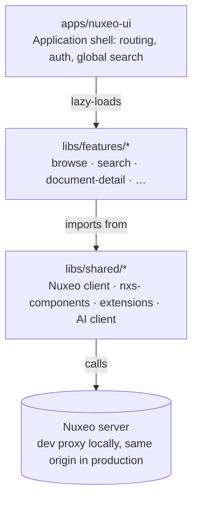

<a id="readme-top"></a>

<div align="center">

# 🧭 Nuxeo Satori UI

**A modern, customisable web interface for Nuxeo content repositories.**<br>
Delivered as a Nuxeo Marketplace package · Built with Angular 22 on the Hyland Satori design system


<a href="https://github.com/nuxeo/Nuxeo-Satori-UI/actions/workflows/ci.yml"></a>
<a href="https://github.com/nuxeo/Nuxeo-Satori-UI/actions/workflows/codeql.yml"></a>
<a href="https://github.com/nuxeo/Nuxeo-Satori-UI/actions/workflows/a11y.yml"></a>
<a href="https://github.com/nuxeo/Nuxeo-Satori-UI/actions/workflows/sonarcloud.yml"></a>
<a href="https://github.com/nuxeo/Nuxeo-Satori-UI/actions/workflows/storybook-pages.yml"></a>
<a href="https://github.com/nuxeo/Nuxeo-Satori-UI/actions/workflows/dependency-review.yml"></a>

<br>

[🎨 Customise it](CUSTOMISING.md) ·
[⚡ Short version](documentation/20-product/00-the-short-version.md) ·
[🛠️ Developer setup](#-getting-started-contributors) ·
[📚 Documentation](documentation/README.md) ·
[🔒 Security](SECURITY.md)

</div>

---

## 📖 About

Nuxeo Satori UI is a web interface for a Nuxeo content repository. It runs in the browser, talks
to your Nuxeo server, and is delivered as a Nuxeo Marketplace package. You change it by
configuration, or with your own code, and upgrades never overwrite your changes.

|                     |                                                                                |
| ------------------- | ------------------------------------------------------------------------------ |
| 🏷️ **Status**       | Beta                                                                           |
| 📦 **Package**      | `nuxeo-agentic-ui` (Nuxeo Marketplace)                                         |
| 🗂️ **Repository**   | `nuxeo/Nuxeo-Satori-UI`                                                        |
| 🧰 **Requirements** | Node.js `^24.15.0` (see [`.nvmrc`](.nvmrc)), npm 11, a Nuxeo server            |
| 🔒 **Security**     | [SECURITY.md](SECURITY.md): report vulnerabilities privately, never via issues |

### 🏗️ Built with


<details>
<summary><strong>📑 Table of contents</strong></summary>

- [🧭 Choose your path](#-choose-your-path)
- [✨ Features](#-features)
- [🏛️ Architecture](#-architecture)
- [🗺️ Repository layout](#-repository-layout)
- [🧱 Technology stack](#-technology-stack)
- [🚀 Getting started (contributors)](#-getting-started-contributors)
- [🐳 Local development stack](#-local-development-stack)
- [⌨️ Common commands](#-common-commands)
- [🧪 Testing](#-testing)
- [🚦 Quality gates](#-quality-gates)
- [📦 Build and package](#-build-and-package)
- [🌍 Internationalisation](#-internationalisation)
- [🔄 CI/CD workflows](#-cicd-workflows)
- [⚙️ Configuration and environment](#-configuration-and-environment)
- [🎛️ Customisation model](#-customisation-model)
- [🩺 Troubleshooting](#-troubleshooting)
- [📚 Documentation](#-documentation)
- [🤝 Contributing](#-contributing)
- [🔒 Security](#-security)
- [📄 Licence](#-licence)

</details>

## 🧭 Choose your path

| You want to…                                                           | Go to                                                                                                |
| ---------------------------------------------------------------------- | ---------------------------------------------------------------------------------------------------- |
| 🎨 Rebrand or rearrange the product (name, logo, colours, menus, tabs) | [CUSTOMISING.md](CUSTOMISING.md): needs Node.js only, no registry token, no account                  |
| ⚡ Understand what the product does and does not do                    | [The short version](documentation/20-product/00-the-short-version.md) (five minutes)                 |
| 🤖 Customise with an AI coding agent                                   | [Prompt library](https://github.com/nuxeo-sandbox/nuxeo-agentic-ui-prompts)                          |
| 🛠️ Work on Satori itself                                               | Continue below, then [Developer getting started](documentation/30-engineering/01-getting-started.md) |
| 📥 Install the platform packages in your own project                   | [docs/installing-satori-platform.md](docs/installing-satori-platform.md)                             |

> [!IMPORTANT]
> The commands under [Getting started](#-getting-started-contributors) are for people developing
> Satori itself and need credentials a customer has no reason to hold. **Customising Satori does
> not.**

<p align="right">(<a href="#readme-top">back to top</a>)</p>

## ✨ Features

- 📁 **Content management**: browse, search (full text, filters, saved searches), preview, create,
  upload, edit, move, copy, delete, and restore from the trash.
- 🛡️ **Governance**: versions, permissions, history, comments, tags, collections, favourites and
  publishing.
- ✅ **Work**: workflow tasks, plus administration of users, groups and vocabularies.
- 🌍 **Localised**: English, French, German, Japanese and Dutch.
- ♿ **Accessible**: WCAG 2.1 AA is the quality bar. CI runs a static template scan; the live axe
  scan runs locally against a Nuxeo.
- 🎛️ **Customisable**: four layers, from settings to your own code, with upgrade-safe overrides.
- 🧩 **Extensible**: a registry of extension points for menus, actions, tabs and columns.
- 🔌 **Optional server-side capabilities**: Knowledge Discovery and the ARender annotation viewer
  each need a separate server component. Without them those features are unavailable and the rest
  of the application works normally. See [docs/knowledge-discovery.md](docs/knowledge-discovery.md).
- 🚫 **AI features** (natural-language search, summaries, tag suggestions, chat) are **inactive in
  this release**: the `AI_FEATURES_ENABLED` flag is off and the AI gateway refuses operations.
  Installing the AI backend does not enable them; turning them on needs a code change and a
  release.

<p align="right">(<a href="#readme-top">back to top</a>)</p>

## 🏛️ Architecture

An Nx monorepo with strict, lint-enforced layering. Features never import one another.



- 🧱 UI is built on the `nxs-` components. [`libs/shared/satori-components`](libs/shared/satori-components)
  holds the Angular Material-backed implementations, and
  [`libs/shared/satori-components-satori`](libs/shared/satori-components-satori) supplies optional
  implementations on `@hylandsoftware/satori-ui`. Adoption is in progress: some feature code
  still imports `@hylandsoftware/satori-ui` directly.
- 🚧 Module boundaries are enforced by `@nx/enforce-module-boundaries` rules in
  [`eslint.config.mjs`](eslint.config.mjs); every project carries `scope:` and `type:` tags.
- 📐 Full detail: [docs/architecture.md](docs/architecture.md) and
  [AGENTS/00-architecture.md](AGENTS/00-architecture.md).

<p align="right">(<a href="#readme-top">back to top</a>)</p>

## 🗺️ Repository layout

| Path                              | Purpose                                                           |
| --------------------------------- | ----------------------------------------------------------------- |
| `apps/nuxeo-ui`                   | The application (shell and top-level routes)                      |
| `apps/nuxeo-ui-e2e`               | End-to-end tests (Playwright)                                     |
| `apps/nuxeo-satori-template`      | Starter application for customer projects                         |
| `libs/features/*`                 | Feature libraries, lazy-loaded                                    |
| `libs/shared/*`                   | Shared libraries: Nuxeo client, components, extensions, AI client |
| `libs/core`                       | Core services                                                     |
| `libs/platform`                   | Publishable platform packages for customers                       |
| `libs/extensions/acme-extensions` | Reference customer extension library                              |
| `libs/integration-tests`          | Integration tests against a live Nuxeo                            |
| `nuxeo-agentic-core`              | Nuxeo server-side module (Maven)                                  |
| `nuxeo-agentic-ui-package`        | Nuxeo Marketplace package (Maven)                                 |
| `scripts/`, `tools/`              | Quality gates, evidence harness, i18n and documentation tooling   |
| `docs/`, `documentation/`         | Engineering records and the structured documentation set          |
| `AGENTS/`, `.cursor/`             | Contracts and playbooks for AI coding agents                      |

<p align="right">(<a href="#readme-top">back to top</a>)</p>

## 🧱 Technology stack

| Area                | Technology                                                                                  |
| ------------------- | ------------------------------------------------------------------------------------------- |
| 🅰️ Framework        | Angular ~22.2 (standalone components, signals), TypeScript, RxJS                            |
| 🧩 Monorepo         | Nx 23, enforced module boundaries and tags                                                  |
| 🎨 UI               | `@hylandsoftware/satori-ui`, Angular Material, in-house `nxs-` components                   |
| 🌍 i18n             | `@ngx-translate/core`, Crowdin                                                              |
| 🧪 Unit tests       | Vitest                                                                                      |
| ♿ E2E and a11y     | Playwright, axe-core and Angular template lint (Playwright and axe are installed on demand) |
| 🛡️ Quality          | ESLint, Prettier, Husky, lint-staged, SonarCloud, CodeQL                                    |
| 📦 Server packaging | JDK 21 and Maven 3.9+ (Nuxeo Marketplace package and OSGi bundle)                           |
| 🐳 Local backend    | Nuxeo Server and OpenSearch in Docker; optional ARender and Mailpit                         |

The full matrix, with the reason for each choice, is in
[Technology stack](documentation/30-engineering/05-technology-stack.md).

<p align="right">(<a href="#readme-top">back to top</a>)</p>

## 🚀 Getting started (contributors)

> [!TIP]
> **📖 A complete walk-through, including starting Nuxeo, is in [Developer getting started](documentation/30-engineering/01-getting-started.md).**
> Budget about two hours, most of it Docker pulling Nuxeo. The steps below are the high-level path.

### 📋 1. Prerequisites

| Requirement                       | Version                                                      | Why                                                                                              |
| --------------------------------- | ------------------------------------------------------------ | ------------------------------------------------------------------------------------------------ |
| 🟢 **Node.js**                    | `^24.15.0`                                                   | Pinned in [`.nvmrc`](.nvmrc). Angular 22 refuses Node 20; run `nvm use`                          |
| 📦 **npm**                        | 11.x (ships with Node 24)                                    | The lockfile is `lockfileVersion` 3                                                              |
| 🐳 **Docker** + Compose           | any current                                                  | Runs Nuxeo and OpenSearch, and optionally ARender and Mailpit                                    |
| ☕ **JDK 21** + Maven 3.9+        | only to build the Marketplace package                        |                                                                                                  |
| 🔑 **`SATORI_GH_READONLY_TOKEN`** | GitHub token with `read:packages` on the Hyland organisation | `@hylandsoftware/satori-ui` installs from GitHub Packages; without it `npm ci` fails with `E401` |

### 📥 2. Clone and install

```bash
git clone https://github.com/nuxeo/Nuxeo-Satori-UI.git
cd Nuxeo-Satori-UI
nvm use                                        # reads .nvmrc -> Node 24
export SATORI_GH_READONLY_TOKEN=<token>
npm ci                                         # never a bare npm install
```

> [!WARNING]
> **Always use `npm ci`.** A bare `npm install` on macOS prunes optional platform entries that
> Linux needs, and the committed lockfile then fails to install in CI. To add a dependency,
> restore a known-good `package-lock.json`, merge in only the new entries, then run
> `npm run beta:lockfile`.

### 🗄️ 3. Start the backend

The app is a client; without Nuxeo it renders empty shells. Run Nuxeo with OpenSearch in Docker
(container `nuxeo`, port 8080). Setup is in [docs/opensearch-setup.md](docs/opensearch-setup.md),
and the server-side config fragments are in [`nuxeo-conf/`](nuxeo-conf).

```bash
export NUXEO_USER=<user> NUXEO_PASS=<password>   # required, no defaults
docker ps                # is a `nuxeo` container already running on :8080?
npm run beta:backend     # expect: Nuxeo is serving at http://localhost:8080 (HTTP 200)
```

> [!NOTE]
> `beta:backend` only checks the server, and starts a `nuxeo` container that already exists but
> is stopped. It cannot create a Nuxeo stack: create yours first, as described in the setup guide.

### 💻 4. Run the application

```bash
npm run dev                                       # same as: npx nx serve nuxeo-ui
```

Open **http://localhost:4200** (with `NUXEO_USER` and `NUXEO_PASS` still exported). The dev server proxies `/nuxeo` to `localhost:8080` through
[`apps/nuxeo-ui/proxy.conf.json`](apps/nuxeo-ui/proxy.conf.json), so reach Nuxeo through `:4200`,
never `:8080` directly, in tests.

| App                     | Purpose                                                                                         |
| ----------------------- | ----------------------------------------------------------------------------------------------- |
| `nuxeo-ui`              | The product: every feature library, Material and the Satori design system                       |
| `nuxeo-satori-template` | The forkable customer template, on plain Angular Material. `npx nx serve nuxeo-satori-template` |

### 🚦 5. Run the checks

```bash
npm run beta:gate -- --gates lockfile,guardrails,lint   # fast inner loop
npm run beta:gate -- --phase my-change                  # full gate before a PR
```

### 📚 6. Read before writing code

1. [`AGENTS.md`](AGENTS.md): architecture and conventions on one page.
2. [`CLAUDE.md`](CLAUDE.md): the hard-won rules and the non-negotiables.
3. [`AGENTS/11-beta-program.md`](AGENTS/11-beta-program.md) section 3: verified facts. Prove one
   wrong before acting against it.
4. The `AGENTS/` file for your task: services, Nuxeo APIs, test standards, security, bug patterns.

<details>
<summary><strong>📏 The non-negotiable conventions</strong></summary>

- `standalone: true` on every component, no NgModules
- `inject()` for DI, never constructor parameters
- `signal()` for mutable UI state, never `BehaviorSubject`
- `takeUntilDestroyed()` on every `.subscribe()`
- `templateUrl` always, no inline templates
- Never ``: fetch through a service, use a blob URL, revoke on destroy
- Never cross-feature imports: shared logic goes in `libs/shared/`. Enforced by `depConstraints`;
  an untagged project cannot depend on anything, so a new library needs `scope:` and `type:` tags
- Third-party component types never appear in our public API; a feature uses the `nxs-` wrapper
- Anything a customer might change goes through Layer 0 or 1, not a hardcoded value

</details>

### 🌿 7. Your first contribution

```bash
git checkout -b fix/<short-description>      # never commit to main
# make the smallest change that satisfies a stated assertion, with a unit test
npm run beta:gate -- --gates lockfile,guardrails,lint
npm run beta:gate -- --phase my-change
git commit                                   # Husky runs ESLint --fix and Prettier
git push -u origin HEAD
gh run list --branch fix/<short-description> --limit 3   # only CI is authoritative
```

Commit conventions are in [AGENTS/06-git-workflow.md](AGENTS/06-git-workflow.md). Pushing again
cancels the previous CI run, so a `cancelled` result on an older commit is expected.

> [!NOTE]
> 📖 Stuck on something? **A complete walk-through, including starting Nuxeo, is in
> [Developer getting started](documentation/30-engineering/01-getting-started.md)**, with a
> common-problems table and the extension guide.

<p align="right">(<a href="#readme-top">back to top</a>)</p>

## 🐳 Local development stack

The application is a client; it needs a running Nuxeo to be useful.

| Component             | How to run                                                                                     |
| --------------------- | ---------------------------------------------------------------------------------------------- |
| 🗄️ Nuxeo + OpenSearch | Docker, container `nuxeo`, port 8080. See [docs/opensearch-setup.md](docs/opensearch-setup.md) |
| ⚙️ Server-side config | Fragments in [`nuxeo-conf/`](nuxeo-conf)                                                       |
| 💻 The app            | `npm run dev` serves on `:4200` and proxies `/nuxeo` to `:8080`                                |
| 👁️ ARender (preview)  | See below, and [docs/arender-setup.md](docs/arender-setup.md)                                  |
| ✉️ Mailpit (SMTP)     | See below. Captures permission-notification email                                              |

```bash
# Optional: rich document preview
docker compose -f arender-docker-compose.yml --env-file .env.arender up -d

# Optional: local SMTP for permission notifications
docker compose -f mailpit-docker-compose.yml up -d

# Check the backend is reachable
npm run beta:backend
```

<p align="right">(<a href="#readme-top">back to top</a>)</p>

## ⌨️ Common commands

```bash
# Run
npm run dev                       # serve the app at http://localhost:4200

# Build
npx nx build nuxeo-ui             # production build

# Test and lint
npx nx test <project>             # unit tests for one project (e.g. browse)
npm run lint                      # lint every project
npm run a11y                      # accessibility scan

# Explore and verify
npx nx graph                      # visualise the project dependency graph
npm run beta:state                # programme status, checked against evidence
npm run beta:gate -- --gates lockfile,guardrails,lint   # fast inner-loop gates
```

Every command runs the same in PowerShell, macOS and Linux terminals.

<p align="right">(<a href="#readme-top">back to top</a>)</p>

## 🧪 Testing

| Level         | Command                    | Notes                                                                                                                                                                                                                                                                                         |
| ------------- | -------------------------- | --------------------------------------------------------------------------------------------------------------------------------------------------------------------------------------------------------------------------------------------------------------------------------------------- |
| Unit          | `npx nx test <project>`    | Vitest. Runs without a backend                                                                                                                                                                                                                                                                |
| Integration   | `npm run beta:integration` | Runs against a live Nuxeo and **creates and deletes documents and users**. Needs `NUXEO_USER`, `NUXEO_PASS` and `INTEGRATION_ALLOWED_HOSTS` (e.g. `localhost:8080`); with the allowlist unset it refuses every host. See [libs/integration-tests/README.md](libs/integration-tests/README.md) |
| End to end    | `npm run beta:e2e`         | Playwright against the running app and a seeded Nuxeo. Needs `NUXEO_USER`, `NUXEO_PASS` and `E2E_ALLOWED_HOSTS` (falls back to `INTEGRATION_ALLOWED_HOSTS`); the preflight exits with code 2 if the app, Nuxeo or the allowlist is missing                                                    |
| Accessibility | `npm run a11y`             | Static template-lint scan, ratcheted against a baseline. It is a regression check, not proof of WCAG 2.1 AA; the live axe scan needs a running Nuxeo                                                                                                                                          |
| Coverage      | `npm run beta:coverage`    | Ratchet: fails if a project's coverage drops below its recorded baseline, with higher floors for listed projects. The 90% target is not yet enforced everywhere                                                                                                                               |

Test standards are in [AGENTS/05-test-standards.md](AGENTS/05-test-standards.md).

<p align="right">(<a href="#readme-top">back to top</a>)</p>

## 🚦 Quality gates

`npm run beta:gate` runs the full pipeline: lockfile integrity, guardrails, lint, unit tests,
build and typecheck. Run it before opening a pull request.

```bash
npm run beta:gate -- --phase <phase-id>   # full gate for a phase
```

> [!NOTE]
> Two things to know.
>
> - **`test` does not typecheck.** Vitest strips types, so a green test run is not type safety;
>   only `build` and `typecheck` catch a `TS` error.
> - **A gate is only trusted once seen failing.** Break it on purpose and confirm it goes red.

Details: [Dev harness and gates](documentation/30-engineering/08-dev-harness-and-gates.md) and
[Testing and evidence](documentation/30-engineering/12-testing-and-evidence.md).

<p align="right">(<a href="#readme-top">back to top</a>)</p>

## 📦 Build and package

Three artifacts ship from this repository:

| Artifact                    | Built by                          | Contains                                                      |
| --------------------------- | --------------------------------- | ------------------------------------------------------------- |
| 📦 Marketplace package      | Maven: `nuxeo-agentic-ui-package` | The built Angular app, the OSGi bundle and the default config |
| ☕ `nuxeo-agentic-core`     | Maven                             | Small OSGi module: auth and start-page configuration          |
| 📚 `@nuxeo/satori-platform` | `npx nx build platform`           | The npm package customers extend the product with             |

```bash
# Angular application
npx nx build nuxeo-ui --configuration=production --base-href=/nuxeo/agentic-ui/

# Marketplace ZIP (JDK 21, Maven 3.9+)
mvn clean package -pl nuxeo-agentic-ui-package -am

# Platform package -> dist/libs/platform
npx nx build platform
```

Deployment, the server-side configuration model, rollback and publishing are covered in
[Deployment and troubleshooting](documentation/30-engineering/13-deployment-and-troubleshooting.md).

<p align="right">(<a href="#readme-top">back to top</a>)</p>

## ⚙️ Configuration and environment

| Variable                   | Purpose                                             | Required for         |
| -------------------------- | --------------------------------------------------- | -------------------- |
| `SATORI_GH_READONLY_TOKEN` | GitHub Packages read access for `@hylandsoftware/*` | `npm ci`             |
| `NUXEO_USER`, `NUXEO_PASS` | Credentials for a Nuxeo server; no defaults         | Tests, evidence runs |

Credentials come from the environment only. Never hard-code them or put them in a URL.

<p align="right">(<a href="#readme-top">back to top</a>)</p>

## 🌍 Internationalisation

The UI ships in 🇬🇧 English, 🇫🇷 French, 🇩🇪 German, 🇯🇵 Japanese and 🇳🇱 Dutch. Strings are managed
in Crowdin (see [`crowdin-conf.yml`](crowdin-conf.yml)); push, pull and status run as GitHub
Actions workflows.

```bash
npm run i18n:pseudo    # generate the pseudo-locale
npm run i18n:audit     # find untranslated or truncated strings
```

Plan and current coverage: [docs/i18n-localization-plan.md](docs/i18n-localization-plan.md) and
[docs/i18n-status.md](docs/i18n-status.md).

<p align="right">(<a href="#readme-top">back to top</a>)</p>

## 🔄 CI/CD workflows

| Workflow                                                   | Purpose                                        |
| ---------------------------------------------------------- | ---------------------------------------------- |
| ✅ `ci.yml`                                                | Lint, test, build, typecheck and bundle budget |
| ♿ `a11y.yml`                                              | Accessibility scan                             |
| 🔍 `codeql.yml`, `sonarcloud.yml`, `dependency-review.yml` | Static analysis and dependency review          |
| 📦 `build-marketplace.yml`                                 | Builds the Marketplace package                 |
| 🚢 `release.yml`                                           | Manual release                                 |
| 📤 `publish-platform.yml`                                  | Publishes the platform package                 |
| 📖 `storybook-pages.yml`                                   | Publishes the component Storybook              |
| 🌍 `crowdin-push.yaml`, `crowdin-pull.yaml`                | Translation sync                               |

<p align="right">(<a href="#readme-top">back to top</a>)</p>

## 🎛️ Customisation model

Every change falls into one of four layers, so customers can upgrade without losing their work:

| Layer    | What you change                                                       | Code needed | Rebuild |
| -------- | --------------------------------------------------------------------- | ----------- | ------- |
| 🟢 **0** | Settings: product name, logo, colours, language, wording              | No          | No      |
| 🟢 **1** | Arrangement: menu entries, buttons, tabs, columns, order and audience | No          | No      |
| 🟠 **2** | Your own screens, actions and conditions                              | Yes         | Yes     |
| 🔵 **3** | Agent harness: instructions, generators and checks for AI agents      | Shipped     | n/a     |

Your configuration ships as your own Marketplace package that depends on ours; upgrades never
overwrite it. The registered extension IDs are listed in
[docs/extension-reference.md](docs/extension-reference.md).

> [!CAUTION]
> Hiding an action in a manifest is not a security control. Server-side Nuxeo permissions still
> gate every operation.

<p align="right">(<a href="#readme-top">back to top</a>)</p>

## 🩺 Troubleshooting

| Symptom                                                      | Cause and fix                                                                                                                                                                                               |
| ------------------------------------------------------------ | ----------------------------------------------------------------------------------------------------------------------------------------------------------------------------------------------------------- |
| `npm ci` fails with `E401` or `E404`                         | `SATORI_GH_READONLY_TOKEN` is missing or lacks `read:packages` on the Hyland organisation                                                                                                                   |
| `npm ci` passes locally, fails in CI                         | A bare `npm install` pruned Linux-only entries. Restore the lockfile and run `npm run beta:lockfile`                                                                                                        |
| Build refuses to start                                       | Wrong Node version. Run `nvm use` (Node 24)                                                                                                                                                                 |
| Empty lists, or 403 on `/nuxeo/api`                          | Nuxeo isn't running on `:8080`, or the session is unauthenticated                                                                                                                                           |
| AI features missing or no `AI.*` requests in the network tab | AI is inactive in this release: the kill switch is on and the gateway refuses operations, so no request is sent. Installing the AI backend does not change this                                             |
| Rich-format preview fails                                    | ARender isn't running. Start its compose stack                                                                                                                                                              |
| Permission emails don't arrive                               | No SMTP locally. Start Mailpit                                                                                                                                                                              |
| Config change has no effect under `nx serve`                 | Re-run `npm run config:dev` **with your fragments** (`-- --bootstrap <file> --manifest <file>`), then restart the dev server. Without arguments it writes the defaults only and discards your customisation |

More rows: [Deployment and troubleshooting](documentation/30-engineering/13-deployment-and-troubleshooting.md).

<p align="right">(<a href="#readme-top">back to top</a>)</p>

## 📚 Documentation

| Document                                                   | Audience                       |
| ---------------------------------------------------------- | ------------------------------ |
| [documentation/README.md](documentation/README.md)         | Index, by role                 |
| [CUSTOMISING.md](CUSTOMISING.md)                           | Customers                      |
| [docs/architecture.md](docs/architecture.md)               | Engineers                      |
| [docs/developer-guide.md](docs/developer-guide.md)         | Engineers                      |
| [docs/api-integrations.md](docs/api-integrations.md)       | Engineers — Nuxeo API registry |
| [docs/beta-plan.md](docs/beta-plan.md)                     | Plan of record for the Beta    |
| [docs/extension-reference.md](docs/extension-reference.md) | Extension authors              |
| [AGENTS.md](AGENTS.md) and [`AGENTS/`](AGENTS)             | AI coding agents               |
| [CHANGELOG.md](CHANGELOG.md)                               | Everyone                       |

<p align="right">(<a href="#readme-top">back to top</a>)</p>

## 🤝 Contributing

1. 🌿 Branch from `main` and keep changes focused.
2. 📏 Follow the conventions in [AGENTS.md](AGENTS.md): standalone components, `inject()`, signals,
   `takeUntilDestroyed()`, external templates, no cross-feature imports.
3. 🚦 Run `npm run beta:gate` and make sure it is green.
4. 🔀 Open a pull request using the [template](.github/PULL_REQUEST_TEMPLATE.md).

<p align="right">(<a href="#readme-top">back to top</a>)</p>

## 🔒 Security

Do not report vulnerabilities through public issues or pull requests. Follow
[SECURITY.md](SECURITY.md).

## 📄 Licence

This repository does not currently ship a `LICENSE` file. Confirm terms with Hyland before
redistributing.

<p align="right">(<a href="#readme-top">back to top</a>)</p>
