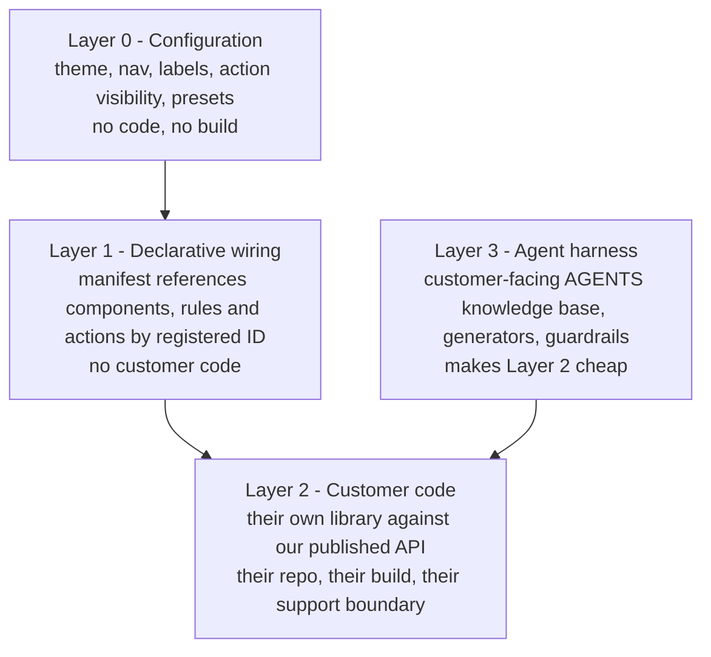
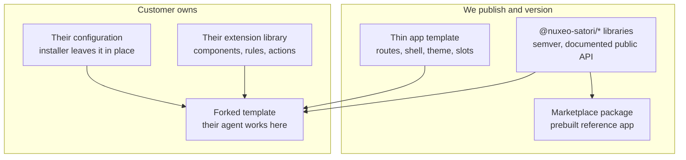

# Beta Deliverable — Plan

**Status:** current plan of record · **Last verified:** 24 August 2026
**Position:** see [Programme status](#programme-status) below, or `npm run beta:state`
**Tickets:** [NXENG-619](https://hyland.atlassian.net/browse/NXENG-619) under [NXENG-615](https://hyland.atlassian.net/browse/NXENG-615)
**RFC:** "RFC: Nuxeo Satori Beta - Component Platform and Customer Extensibility Model"
**Agent contract:** [`AGENTS/11-beta-program.md`](../AGENTS/11-beta-program.md) · **Harness:** [`scripts/beta-harness/`](../scripts/beta-harness/)

---

## Programme status

**As at 23 November 2026.** `CLAUDE.md` points here for the authoritative position, and for
weeks there was no such section — so that pointer dangled while `CLAUDE.md`'s own summary
claimed Phase 3 was next, three phases after it had shipped.

Run `npm run beta:state` for the machine-checked version. It reads
`.ai/state/phases.json`, resolves each cited evidence manifest and gate report, and is red
whenever a phase claims more than the artifacts support. **Prefer it to this table**, which
is a human summary and can go stale exactly as its predecessor did.

| Phase                            | Status                   | Evidence                                             |
| -------------------------------- | ------------------------ | ---------------------------------------------------- |
| 0 — Verify and unblock           | complete                 | 14 checks at sign-off; 12 since 2026-11-02           |
| 1 — Layer 0 config               | **in progress**          | 39 checks at sign-off; now 39 of 40                  |
| 2 — Layer 1 extension registry   | **in progress**          | 46 checks at sign-off; now 42 of 43                  |
| 3 — Component adoption           | **superseded**           | 55 checks at sign-off                                |
| 4 — Layer 2 publishable platform | complete with deviations | 25 checks at sign-off; 18 on the signed-out template |
| 5 — Layer 3 agent harness        | complete                 | 27 checks                                            |
| 6 — Beta quality bar and proof   | **in progress**          | 5 of 7; steps 3 and 6 open                           |

Phases 0–5, all signed off by 24 August 2026, each cite a re-gate on 2026-11-03 against the
whole pipeline as it then stood, 35 of 35 gates green (NXSAT-660), not only against the smaller
pipeline that existed when each was signed off — Phases 0–2 were originally gated on 4–6 gates.
The re-gate matters: two of the gates added since found real defects in already-signed-off
work. It does not make a phase complete: Phases 1 and 2 are back in progress, and Phase 3 is
superseded. Gates have been added since 2026-11-03, so that re-gate no longer covers the whole
pipeline. `npm run beta:state` says so only for the complete phases, 0, 4 and 5, and only where
their evidence and gate reports are on disk and pass. It does not check the re-gate of a phase
in progress or superseded, so the absence of a warning for Phases 1, 2 and 3 says nothing about
their gate coverage.

**Deviations are recorded per phase in `.ai/state/phases.json`, not here.** Phase 4 carries
twelve, including the one that mattered most: the published package could not be published at
all for the whole phase. Read them before treating a phase as settled.

An independent adversarial review after Phase 5 found defects in every phase, and the
remediation is in git history from `0ccf3f0` onward — publishability, module boundaries,
five defeated gates, and nine security defects across blob-URL lifecycles, subscription
teardown and one `` bypassing the HTTP interceptor.

---

## Decisions locked

- **Components:** the UI is built on our own `nxs-` Satori components
  (`libs/shared/satori-components`). No vendoring, no permanent lookalikes.
- **Beta scope:** a deep core slice — browse, folder tree, search, document detail, metadata,
  permissions, versions, upload/CRUD. Workflow, users and groups, administration and publishing
  are out.
- **Customisation model:** a four-layer extensibility contract. AI agents are the authoring
  accelerator for that contract, **not** a licence to edit our source. The contract is the product.
- **Distribution:** versioned libraries plus a thin forkable app template.
- **Layer 1 is additive for Beta, deliberately.** A manifest can add nav items, routes, toolbar
  actions, tabs, context-menu items, bulk actions and columns, and can hide, reorder or relabel
  packaged entries. It **cannot** replace or withdraw a shipped route, or change what a packaged
  document-detail tab renders: `app.routes.ts` imports each feature's `Routes` array directly so
  no packaged route carries an ID, and the six packaged tab bodies are markup rather than
  addressable components. Making either addressable is a rewrite, not a refactor, and is deferred
  to GA. One exception, added by NXSAT-316: a `documentView` entry can outrank the View tab body
  for the documents its rule matches, rendering a Layer 2 component in its place. The packaged
  View is still markup and still renders whenever no entry matches; which packaged piece that
  is (note editor or document viewer) is chosen per type from one internal table. Section 13 of `docs/extension-reference.md` states this to customers, and the slot-state
  table in section 2 is gated by `npm run beta:reference` so it cannot drift.
- **The 90% coverage bar applies to the in-scope slice only.** Projects the scope decision above
  puts out — administration, workflow tasks, KD/KE, assets, trash — plus the reference extension
  libraries and the forkable template, are named in `OUT_OF_SCOPE` in
  `scripts/beta-harness/coverage-gate.mjs` and excused from the bar, but **not** from the ratchet:
  out-of-scope code may still not rot. The default is in-scope, so a new library counts until
  someone argues otherwise. Quote `betaScope.meetingTargetInScope` from the gate's JSON, not the
  whole-repo `meetingTarget`, which mixes the two and overstates both the denominator and the debt.

## The extensibility contract



Layers 0 and 1 are expected to absorb most customer requests and need no build. Layer 2 exists
because a manifest can only rewire what is already compiled in. Layer 3 is the differentiator: the
agent works inside the customer's extension library and the thin template, never in our library
source, which is what preserves the support boundary and the certification claims in NXENG-615.

> **Assumption to validate:** that Layers 0 and 1 cover most requests is a design expectation, not
> a measured fact. Test it against real requests from The Church and one other account before
> Phase 2 fixes the addressable surface.

## Distribution and upgrade model



Upgrades are an npm version bump for the platform, plus occasional small merges in the template.
That is only true if the public API is genuinely stable — see the encapsulation rule in Phase 3.

### Where configuration lives

The marketplace installer is destructive today:

```xml
<copy dir="${package.root}/web" todir="${env.server.home}/nxserver" overwrite="true" />
```

So configuration must not live inside the packaged `web` directory. Split it:

- **Bootstrap config** (pre-auth: Nuxeo server URL, base href, branding shell, manifest location)
  on a static path the installer does not overwrite, requiring a second non-overwriting copy step
  in [`nuxeo-agentic-ui-package/src/main/resources/install.xml`](../nuxeo-agentic-ui-package/src/main/resources/install.xml).
  _Superseded 2026-10-07 (NXSAT-317): the non-overwriting copy broke the upgrade once the file was
  edited. The package now ships only a sample and never installs the customer's file — see R7._
- **Runtime manifest** (nav, actions, rules, presets, toggles) as a **Nuxeo document** at
  `/default-domain/config/agentic-ui`, fetched through the existing authenticated `HttpClient`,
  with the packaged default as fallback.
  _Superseded 2026-10-07 (NXSAT-312): both halves are now fragments contributed by Marketplace
  packages and served anonymously by `nuxeo-agentic-core` at `agentic-ui-config/`; the Note is no
  longer read, with no migration._ The argument recorded here for the Note — that it inherited
  Nuxeo's versioning, audit, ACLs and per-tenant scoping "for free" and could be edited in-app — is
  **withdrawn, not merely superseded**, and is not restated in another form. A configuration package
  is versioned and attributable: it carries a package version, it is built from reviewable source,
  and `AppConfigService.diagnostics()` names the package component behind every fragment. It gives
  **none of the other three**. Fragments are served anonymously, before sign-in, and nothing about
  configuration changes when a user signs in or out (`docs/extension-reference.md:111`, `:120`), so
  no ACL governs a fragment and there is no per-tenant scoping — which is exactly why nothing
  sensitive may go in one.

---

## Verified facts (established 20 August 2026)

Settled by first-hand inspection. Do not re-litigate; if you contradict one, prove it first.

- **The branch is sound.** `npm ci` succeeds; Material 20.2.14, TypeScript 5.8.3, Satori 0.2.0 and
  hxcs-js-client 2.0.111 match HFA `develop`; guardrails, lint and build all pass; 280 of 281 tests
  pass. **Angular deliberately no longer matches**: this repo runs 20.3.31 where HFA `develop` runs
  20.3.27, because two published advisories put `>=20.0.0 <20.3.28` in the vulnerable range — one of
  them a sanitization bypass in `@angular/core` and `@angular/compiler`. The divergence is a patch
  within the same minor and is the deliberate choice, not drift; matching HFA again means HFA moving
  up, not this repo moving back.

---

## Already done

- Phase 1 core: `libs/shared/app-config`, the config directory beside the bundle (since NXSAT-317
  holding only a packaged sample; the customer's `bootstrap.json` is never installed), eleven tokens
  repointed, config-driven theming and activated i18n. Quality gate 4/4, evidence 38/38.
- Phase 0 verification: dependencies install, gates run, build passes (1.66 MB initial bundle;
  1.69 MB after Phase 1).
- Much of Phase 5: [`scripts/beta-harness/`](../scripts/beta-harness/) (phase evidence runner with
  per-step assertions, verification gate, annotated comparison generator),
  [`AGENTS/11-beta-program.md`](../AGENTS/11-beta-program.md), the `beta-program` rule, and six SDLC
  skills (`beta-phase`, `verify-gate`, `capture-phase-evidence`, `add-extension-point`).
- Baseline evidence against live Nuxeo: 13/13 checks; showcase artifact 18/18.
- Documentation corrected for the AI backend having moved to its own repo.

---

## Phase 0 — Verify and unblock (**complete**)

1. ~~Obtain a `read:packages` token.~~ Done. **Provision it as a long-lived CI secret** — CI still
   cannot install without it.
2. Fix the harness authentication defect: `helpers.login()` injects a session that satisfies the
   route guard but does not reliably authenticate XHRs, producing intermittent `403`s on
   `/nuxeo/api` paths. Use Playwright `httpCredentials`, as
   [`annotate-showcase.mjs`](../scripts/beta-harness/annotate-showcase.mjs) now does.
3. Fix the Node-version test failure: `clipboard.utils.spec.ts` fails on Node 22+ because Node's
   built-in experimental `localStorage` collides with jsdom. CI runs Node 20, contributors do not.
4. Triage the **9 high-severity `npm audit` findings**. NXENG-615 requires no high or critical.

## Phase 1 — Layer 0: upgrade-safe configuration (**in progress**)

**Back in progress since 2026-11-02** (NXSAT-660). The latest run `phases.json` records, on
`9ba733864`, passes 39 of 40 checks: a request the app sends to `/nuxeo/agentic-ui/` from the
browse and themes pages fails, and its source is not yet identified. The gates below are the
sign-off record.

Gates: quality gate **PASS** (4/4 green) · evidence gate **PASS** (38/38 checks, exit 0), after the
remediation below.

> **What the evidence proves, stated precisely.** It proves that configuration alone changes the
> running application's behaviour with a byte-identical bundle, and that absent, denied and
> malformed configuration all leave a working application. It does **not** prove upgrade safety.
> The first cut of the installer targeted `nxserver/web/…`, which is not a docBase and which
> nothing serves; the configuration would have 404'd in every real deployment and the tolerant
> fallback would have hidden it. The path is corrected, and the corrected destination is confirmed
> to be the directory the `/nuxeo` context is served from. Since 2026-09-26 the package is
> built and published — `2026.0.1-20260926071953-BUILD-1109`, live on the preprod listing. The
> **marketplace install rehearsal** ran on 2026-10-07 with `nuxeoctl mp-install` and disproved
> the non-overwriting design — see R7 and NXSAT-317. It is _not_ the `upgrade-rehearsal` gate,
> which crosses a version boundary for the npm tarball (see the Phase 6 step marked Done below). See
> `PHASE-1-REMEDIATION-ADDENDUM.md` in the phase evidence directory.

Delivered:

- `libs/shared/app-config` loads a **bootstrap file** pre-auth and a **runtime manifest** from the
  Nuxeo document at `/default-domain/config/agentic-ui` post-auth, both tolerant of absence, denial
  and malformed JSON. The bootstrap file is read from `nxserver/nuxeo.war/agentic-ui-config`, a
  **sibling** of the bundle and therefore outside its destructive copy. A second `install.xml`
  copy puts only a sample there, `bootstrap.example.json`, with `overwrite="true"`; the customer
  copies it to `bootstrap.json`, which no install, upgrade or uninstall touches (NXSAT-317, R7).
  _Superseded 2026-10-07 (NXSAT-312): both halves are served by the configuration servlet from
  package contributions, fetched together pre-auth; neither a file on disk nor the Note is read._
  The copy first shipped with `overwrite="false"` on `bootstrap.json` itself, and the 2026-10-07
  rehearsal showed that design leaving no version installed after an edit. `nuxeo.war` is the
  Tomcat docBase for the `/nuxeo` context; `nxserver/web` holds only `root.war` and is not served.
- **Eleven `InjectionToken` factories** repointed at the loaded configuration: the Nuxeo API origin
  and server URL, the AI backend prefix, the ARender endpoints, both Content Intelligence operation
  maps, the three SSO tokens and the session timeout. `nuxeo-sso.providers.ts` and its two hardcoded
  SAML registration IDs are deleted.
- **Theming:** `AppThemeId` is no longer a closed four-member union — the theme set comes from
  configuration, each theme carries a CSS-custom-property `tokens` map applied inline to `<html>`,
  and the global override block is token-driven.
- **i18n:** `TranslateModule` was registered but inert; it now loads a real catalogue and layers the
  manifest's `labels` over it, so relabelling is a configuration edit. Extraction covers the slice's
  chrome only.

### Decisions taken 21 August 2026

- **Translations are descoped from Beta.** No further i18n extraction before Beta. The _mechanism_
  stays, because the manifest's `labels` map layers over the catalogue and that is a Layer 0
  capability — a customer relabels without a rebuild. Extraction beyond the slice chrome moves to GA.
- **Remove the residual `!important`.** ~~An appearance change is accepted.~~ **Done, and nothing
  changed visually.** `.sat-tag.sat-tag` beats Satori's component styles on specificity; Satori's
  inline palette is redirected through its own `--sat-tag-*` custom properties; and the dialog
  title needed a 0-3-1 rule to outrank Material's `.mat-typography h2` typography hierarchy.
  Measured before and after by `scripts/beta-harness/steps/phase-1-tag-styles.mjs`.

Remaining, deliberately not attempted:

- An in-app editor for the configuration document. _Superseded 2026-10-07 (NXSAT-312): there is
  no document to edit; configuration ships in the customer's own Marketplace package._

### Configuration document ACLs — removed 2026-11-02 (NXSAT-312)

_The ACL model this section described governed a design that no longer exists: the manifest is not a
Nuxeo document and nothing is read from the repository. The section carried a superseded label from
2026-10-07 and two reviewers quoted it as current anyway, so the text is gone rather than relabelled.
What replaced it is [`docs/extension-reference.md`](extension-reference.md) §2, lines 117-119 — the
manifest is a package fragment served anonymously, before sign-in, with no migration from the Note._

## Phase 2 — Layer 1: extension registry (**in progress**; toolbar/tabs/columns carried to Phase 3)

**Back in progress since 2026-11-02** (NXSAT-660), for the same failing request as Phase 1. The
latest run `phases.json` records, on `9ba733864`, passes 42 of 43 checks. The gates below are
the sign-off record.

Gates: quality gate **PASS** (6/6 green, including the new lockfile and typecheck gates) ·
evidence gate **PASS**.
Reference doc: [`docs/extension-reference.md`](extension-reference.md).

> **What the evidence proves, stated precisely.** It proves that a manifest edit hides, adds,
> reorders, relabels and rule-gates navigation, and that a customer layer wins through
> `$references`. It proves the packaged default reproduces the pre-Phase-2 navigation by ordered
> equality against the ids and labels transcribed from the deleted `const`, not by a count. It
> proves a manifest-added nav item now resolves a registered `sidebar` component instead of a
> placeholder, that a non-administrator is not offered Administration, and that a manifest hides and
> adds a bulk action. It does **not** prove anything about toolbar, tab, context-menu or column
> extensibility, because nothing reads those slots.
>
> **The bundle digests are weaker than first claimed.** Nine steps hash the script bytes on every
> pass, and an earlier version of this section said they would fail "if configuration were dead".
> They would not: the dev server does not rebuild between reloads, so they pass regardless. They rule
> out one alternative explanation — that a rebuild rather than the manifest produced the change — and
> they read `script[src]` only, so a lazy chunk pulled in by dynamic `import()` is outside them. The
> DOM assertions are the load-bearing part.

Delivered:

- **`libs/shared/extensions`**, holding the domain-neutral parts — `mergeObjects` (so `$references`
  layering supports merge-by-id and `.$replace`), `filterEnabled` and `sortByOrder`.
- **Slots are additive by construction.** Keyed by opaque string, with no enum, union or `switch` on
  slot identity, so a tenth slot needs no change to the nine. A spec registers a slot the library has
  never heard of and asserts the nine unchanged. This downgrades **R8 from Medium to Low**: the
  addressable ceiling is now ordinary backlog rather than an irreversible decision.
- **Rules:** the four document-permission predicates registered as `app.rules.*` with no change to
  the predicates. Plus `core.every`/`core.some`/`core.not` as ordinary registered evaluators rather
  than special cases. An **unregistered rule id fails open**, so a manifest typo cannot strip working
  actions out of the UI — safe precisely because Layer 1 visibility is not an authorisation boundary
  — **except** for the three user rules, which fail closed so that an unregistered
  `app.rules.hasAdministrationAccess` cannot offer Administration to everyone during startup.
- **Navbar and sidebar:** `PLATFORM_NAV_ITEMS` is deleted. The same fifteen entries are
  `PACKAGED_NAV_ITEMS` registered into the `navbar` slot behind a signal-backed `APP_NAV_ITEMS`
  token — a signal, not a const, because the manifest arrives asynchronously and nav rules depend on
  the signed-in user. The ~15 path getters in `nav-drawer.component.ts` now key on the nav item id,
  and the shell's hardcoded `path === '/administration'` filter is replaced by a manifest-visible
  `app.rules.hasAdministrationAccess` rule.
- **`ExtensionOutletComponent`**, generalising `DynamicDrawerComponent` via `createComponent()`:
  resolution by registered id, lazy component loaders and input binding. It replaces nav-drawer's
  ad-hoc `Promise.all` of dynamic imports and gives the drawer's fallback branch real content.
- **`$references` merge**, with `$ignoreReferenceList`, `.$replace` and unresolvable layers reported
  rather than swallowed.

Delivered at closure (21 August 2026):

- **The action registry.** `ExtensionActionDescriptor` in a slot says where and when;
  an `ExtensionActionHandler` registered by id says what. `enabledRule` disables rather than hides, which today's UI needs.
- **`bulk-actions` converted.** The six fixed `@Output()` buttons in
  `selection-topbar.component.html` are now `PACKAGED_BULK_ACTIONS` plus six action
  services. Adding a seventh was a button, an output and a shell handler — three files
  across two projects; it is now two registrations. Proven by an ordered-equality spec
  against the ids the markup rendered, and by an evidence step that hides one and adds
  one from a manifest.
- **The document rule context is populated.** Document detail publishes the focused
  document, so `canWrite`, `canRemove`, `canAddChildren`, `canManagePermissions` and
  `hasDocument` work there; `isTrashed`/`isNotTrashed` are added. Selection cardinality
  moves to its own `selectionCount` field so the cardinality rules go live while the
  permission ones stay honestly inert.
- **Fail-closed for security-relevant rules**, a lockfile-integrity gate, a direct
  typecheck target for the library, and `core.not` corrected to NOR.

Not attempted, and carried into the component-adoption phase:

- **The document-detail toolbar, its seven-item overflow menu and its five `mat-tab`
  children**, and browse's row `contextMenu` and `documentList` columns. Those five slot
  ids are reserved and **nothing reads them** — `docs/extension-reference.md` says so
  rather than implying an extension point exists. The toolbar was designed as descriptors
  and then not shipped: eight of its eleven controls carry per-action dynamic state
  (`isLocked`, `isFavorite`, `isSubscribed`, `isInClipboard`, `actionInProgress`,
  `hasVersion`) that the descriptor shape does not yet express, and inventing those fields
  under time pressure risked a visible regression in the most-used page.
- **Route contributions.** `app.routes.ts` still imports feature `Routes` arrays directly.
- **The two selection permission rules remain inert.** `SelectionService` tracks ids, not
  documents, so `app.rules.canWriteSelection` and `app.rules.canRemoveSelection` still
  answer `false`. Making them live costs a fetch per selected row.

## Phase 3 — Component adoption (**superseded**)

The phase adopted an upstream component library behind a proof-of-concept browse route, and was
signed off on 2026-08-24 with 55 checks. The adopted components, their bridge and the route were
removed in October 2026 (NXSAT-635, NXSAT-637), so that adoption no longer exists, and
`.ai/state/phases.json` records the phase as `superseded` (NXSAT-660, 2026-11-02).

Its evidence steps now check the browse page that replaced the route, which is built on our own
`nxs-` Satori components (`libs/shared/satori-components`): 29 of 29 on NXSAT-660's review head.
`phases.json` keeps those checks as a record of that page, not as adoption evidence, so they are
not this phase's sign-off.

## Phase 4 — Layer 2: publishable platform (**complete with deviations**, 12 recorded)

**Narrowed on 2026-11-02** (NXSAT-660): the evidence now checks the forkable template signed out
only, 18 of 18 checks. The signed-in checks need Nuxeo, so they are recorded as notes rather than
assertions.

- Give the libraries real build targets with ng-packagr. Today every `project.json` has only `lint`
  and `test`, and the only artifact is a prebuilt SPA zip — there is nothing for a customer to
  depend on.
- **Declare the public API surface and a semver policy**, with an automated gate so internal types
  cannot leak into it. This is what makes upgrades a version bump rather than a merge.
- Expose the registration API — our equivalent of `setComponents`, `setEvaluators` and
  `setAuthGuards` — so customer code can contribute by ID.
- Build the thin forkable app template and a customer extension-library starter.

## Phase 5 — Layer 3: agent harness (**complete**)

Largely built. Remaining:

- Split the `AGENTS/` knowledge base into internal and customer-facing halves, and version the
  customer-facing half as a product artifact.
- Add Nx generators for "new extension component", "new action", "new rule".
- Package the guardrail script for customer use.

## Phase 6 — Beta quality bar and proof (**5 of 7 steps done**; step 6 open since 2026-09-22, step 3 not met as of 2026-11-23)

- NXENG-615's checklist, assessed against the slice: unit coverage above 90% (the bridge has 11
  tests for 2,949 lines today), ~~Playwright E2E on critical paths~~ (**done** — `npm run beta:e2e`,
  12 specs; not in PR CI because it needs Docker Nuxeo, recorded as a limitation), WCAG 2.1 AA,
  SAST and SCA clean, Chrome and Safari verified.
- **Reference customer extension** exercising Layers 0-2 — a nav item, a rule-gated action, a custom
  component and a rebrand — with zero edits to our libraries.
- ~~**Upgrade rehearsal:** install, customise, upgrade, and verify configuration and extensions
  both survive.~~ **Done** — `npm run beta:upgrade`, gate `upgrade-rehearsal`. Eight assertions
  across Layers 0-2. The decisive one is that every slot the JSON manifest names still exists in
  the upgraded package: nothing type-checks JSON, so a renamed slot leaves the build green and the
  customer's entries silently gone. `--break-slot toolbar` demonstrates exactly that.

**Progress, and what each step still needs**

| Step                        | State                                                                                                                                                                                                                                                                                                                                                                                                                                                                                                                                                                                                                                                                                                                                                                                                                                                                                                                                                                                                                       |
| --------------------------- | --------------------------------------------------------------------------------------------------------------------------------------------------------------------------------------------------------------------------------------------------------------------------------------------------------------------------------------------------------------------------------------------------------------------------------------------------------------------------------------------------------------------------------------------------------------------------------------------------------------------------------------------------------------------------------------------------------------------------------------------------------------------------------------------------------------------------------------------------------------------------------------------------------------------------------------------------------------------------------------------------------------------------- |
| 0 — coverage ratchet repair | **done** — orphaned and unratcheted entries now fail                                                                                                                                                                                                                                                                                                                                                                                                                                                                                                                                                                                                                                                                                                                                                                                                                                                                                                                                                                        |
| 1 — upgrade rehearsal       | **done** — 15th gate, in CI                                                                                                                                                                                                                                                                                                                                                                                                                                                                                                                                                                                                                                                                                                                                                                                                                                                                                                                                                                                                 |
| 2 — Playwright E2E          | **done** — 12 specs, 4 critical paths, phase gate                                                                                                                                                                                                                                                                                                                                                                                                                                                                                                                                                                                                                                                                                                                                                                                                                                                                                                                                                                           |
| 3 — WCAG 2.1 AA met         | **NOT MET as of 2026-11-23.** It was done on 2026-08-24 (7 rule classes fixed, 77 nodes, `KNOWN_VIOLATIONS` empty, 15 cases) and in question from 2026-09-23. `phase-6-a11y/2026-11-23T08-09-11`, captured on `main` at e27deeaa0 with axe-core 4.14.1, fails 15 of 35 checks. 14 are `label-content-name-mismatch` (2.5.3 Label in Name, Level A) on the navigation's user-profile control, which appears on every scanned surface. 1 is a Health 404 on an optional configuration file the local server does not serve, which is an environment condition. The 35/35 of 2026-10-22 used axe-core 4.13.0, which does not run that rule under the WCAG tags. The September `button-name` failures do not reproduce. The control was fixed the same day: `phase-6-a11y/2026-11-23T18-53-44`, with axe-core 4.14.1, passes all 14 axe checks, 34 of 35, and only Health fails, on 404s that are not accessibility findings. That clears the capture, not the step: failures are recorded in states the capture does not reach |
| 4 — SAST + SCA              | **done** — but SAST already existed and was reporting 21 unread alerts, 6 high. Two gates now read the output: `supply-chain` and `code-scanning`                                                                                                                                                                                                                                                                                                                                                                                                                                                                                                                                                                                                                                                                                                                                                                                                                                                                           |
| 5 — Safari/WebKit           | **done** — 34 specs (17 × 2 engines), 5 new specs target engine divergence; WebKit not Safari, distinction recorded                                                                                                                                                                                                                                                                                                                                                                                                                                                                                                                                                                                                                                                                                                                                                                                                                                                                                                         |
| 6 — coverage to 90%         | **REOPENED 2026-09-22** — **10 of 11** in-scope projects meet the bar (was 10 of 10). `shared-ai-client` is at 15.98%. Read the caveat below                                                                                                                                                                                                                                                                                                                                                                                                                                                                                                                                                                                                                                                                                                                                                                                                                                                                                |

**Two steps are open: 3 and 6. Five of the seven are done.**

Step 6 was closed on 2026-08-31 and is REOPENED as of 2026-09-22; step 3 came back into question
on 2026-09-23. Neither was reopened by new work — step 6 because the coverage denominator grew,
step 3 because reading the a11y manifests showed five consecutive failing captures behind a
recorded pass. Both were already true and unrecorded. `shared-ai-client` is an in-scope project at 15.98%, so "coverage to 90%"
is not met on its own terms.

Step 3 was re-measured on 2026-11-23 and is **not met**, and this time the cause is new work. On
2026-10-26 NXSAT-673 put the signed-in user's avatar initials in the navigation's user-profile
control. With the rail collapsed, those initials are all the control shows, and they were not a
word of its accessible name. A newer axe-core reported that as a WCAG 2.5.3 failure on every
screen. The older engine behind the 2026-10-22 pass did not run the rule, so the defect was not
measured until the `--no-save` install, which pinned no version, moved on. The diagnosis and the
two control runs are recorded in `.ai/state/phases.json` and in
[the accessibility standard](accessibility.md#the-2026-11-23-measurement). The capture now pins
the engine that record ran, axe-core 4.14.1, and refuses any other, so a later verdict cannot move
without a commit.

The control was fixed the same day. The shell now names it with `aria-labelledby`: the initials,
then the display name. `phase-6-a11y/2026-11-23T18-53-44` passes all 14 axe checks. It is 34 of
35 because the Health check still fails, on 404s that are not accessibility findings: the local
environment's, its test data's, and the unexplained request that keeps Phases 1 and 2 open.
Step 3 stays open: conformance also needs the failures the standard records in states the capture
does not reach. See
[The fix, measured the same day](accessibility.md#the-fix-measured-the-same-day).

A green `npm run beta:coverage` does not close this, and that is worth being explicit about: the
gate's exit condition is the **ratchet**, not the target. A shortfall against 90% is reported and
never failed on — see `meetingTargetInScope` in `coverage-gate.mjs` — precisely so the bar can be
aspirational without the gate becoming un-passable. So the gate being green and the step being
done are different claims, and reading the first as the second is how this row said 10 of 10 for
three weeks after it stopped being true. The debt was two files rather
than two libraries: `document-detail.ts` held 1,606 of its library's 1,615 uncovered statements
and `browse.ts` held 707 of 1,175, so `browse` went 56.72% → 99.02% and `document-detail`
59.71% → 92.55%. Seven real bugs surfaced in the process, the worst of which crashed the whole
document list during change detection for any document with no `dc:lastContributor`.

**The caveat, which must travel with the number.** These are percentages of the _measured_
subset. Re-measured 2026-09-22: **10,155 source lines across 48 files** are imported by no test at
all, so they contribute no statements and cannot lower any percentage — **6,137 of those lines are
in-scope**. `ui` reports 97.68% with 1,523 lines outside the measurement; `search` reports 93.41%
with a 1,330-line filters drawer outside it; `nuxeo-client` reports 90.28% with 1,835. The worst is
`assets` at 97.44%, which measures 78 statements while 1,644 lines of its two components sit
outside — a figure that is arithmetically true and evidence of nothing.

`npm run beta:coverage` prints an `excluded` column beside every percentage for exactly this
reason, and the entries are dated to 2026-11-30 in
`.ai/state/coverage-uninstrumented-allowlist.json`. Regenerate rather than quoting these:

```bash
# Counts NEWLINES, matching `wc -l` and the per-file figures in the allowlist. `split('\n').length`
# counts the empty segment after a trailing newline too, which inflated this by one per file — 48
# lines across the set, and it is how the assets pair was recorded as 1,646 when 995 + 649 = 1,644.
node -e "const fs=require('fs');const a=require('./.ai/state/coverage-uninstrumented-allowlist.json');\
  let f=0,l=0;for(const p of Object.keys(a.files||{})){if(!fs.existsSync(p))continue;\
  f++;l+=(fs.readFileSync(p,'utf8').match(/\n/g)||[]).length;}console.log(f+' files, '+l+' lines');"
```

So "10 of 11 in-scope projects meet the 90% bar" is true and is the bar as defined. It is not
the same claim as "the in-scope code is 90% tested", and it should not be quoted as though it
were. Closing the remaining 6,137 in-scope lines is comparable in size to the work just completed.

**The figure was 10 of 10 until 2026-09-22, and it was the denominator that moved, not the code.**
`assets`, `tasks` and `shared-ai-client` had never appeared in a coverage report, so nothing
ratcheted them and they were absent from the count in both directions. Reconciling the baseline
brought them in, and `shared-ai-client` arrived at **15.98%** — in scope, because the excluded set
above names KD/KE but not the AI client, and `search` and `document-detail` both consume
`AiGatewayService`.

It was briefly added to `OUT_OF_SCOPE`, which returned the reported figure to 10 of 10 without a
line of production code changing. That was reverted. The reasoning had argued from KD/KE being
excluded — an analogy rather than this document, and this document is the scope contract. The
honest number is 10 of 11, and a project cannot be argued out of scope by editing the gate.

---

## Timeline

| Phase                  | Focused       | With AI support |
| ---------------------- | ------------- | --------------- |
| 0 — Verify and unblock | 1-2 d         | 1 d             |
| 1 — Layer 0 config     | 12-18 d       | 7-11 d          |
| 2 — Layer 1 registry   | 15-22 d       | 9-14 d          |
| 3 — Component adoption | 30-45 d       | 20-29 d         |
| 4 — Layer 2 platform   | 18-26 d       | 11-16 d         |
| 5 — Layer 3 harness    | 4-6 d         | 2-4 d           |
| 6 — Quality and proof  | 20-30 d       | 12-18 d         |
| **Total**              | **100-149 d** | **62-93 d**     |

Roughly 5-7 months focused, or 3-4.5 months with AI support. These are engineering judgements
calibrated against this branch, not measurements; re-baseline against what the early tasks measure.

Against the Q3/Q4 2026 Beta target, only the AI-supported pace fits. **If it slips, gate Beta on
Phases 0-3 plus 6** — Layers 0 and 1, the component slice and the quality bar — and follow with Layers
2 and 3 for GA. That still ships a configurable, upgrade-safe product and defers only
customer-authored code.

## Risks

| #   | Risk                                                                                                                                                                                                                                                                                                                                                                                                                                                                                                                                                                                                                                                                                                                                                                                                                                                                                                                        | Severity           | Mitigation                                                                                                                                                                                                                                                                                                                                                                                                                                                                                                                                                                                                                                                                         |
| --- | --------------------------------------------------------------------------------------------------------------------------------------------------------------------------------------------------------------------------------------------------------------------------------------------------------------------------------------------------------------------------------------------------------------------------------------------------------------------------------------------------------------------------------------------------------------------------------------------------------------------------------------------------------------------------------------------------------------------------------------------------------------------------------------------------------------------------------------------------------------------------------------------------------------------------- | ------------------ | ---------------------------------------------------------------------------------------------------------------------------------------------------------------------------------------------------------------------------------------------------------------------------------------------------------------------------------------------------------------------------------------------------------------------------------------------------------------------------------------------------------------------------------------------------------------------------------------------------------------------------------------------------------------------------------- |
| R5  | **9 high-severity audit findings already.** NXENG-615 requires none.                                                                                                                                                                                                                                                                                                                                                                                                                                                                                                                                                                                                                                                                                                                                                                                                                                                        | Medium             | Triage in Phase 0.                                                                                                                                                                                                                                                                                                                                                                                                                                                                                                                                                                                                                                                                 |
| R6  | This branch carries the monorepo Angular 20 upgrade while `main` is on 19.                                                                                                                                                                                                                                                                                                                                                                                                                                                                                                                                                                                                                                                                                                                                                                                                                                                  | Medium             | Land the upgrade as its own PR first.                                                                                                                                                                                                                                                                                                                                                                                                                                                                                                                                                                                                                                              |
| R7  | **Rehearsed 2026-10-07: the claim that `overwrite="false"` preserves customer edits was disproved, and NXSAT-317 fixes it.** With `bootstrap.json` edited on the server, upgrading the package failed and left **no version installed** (`/nuxeo/agentic-ui/` 404): the old version's md5-checked uninstall leaves the edited file, and the new version's `overwrite="false"` copy throws on it. The package now ships only `bootstrap.example.json`; the customer's `bootstrap.json` is never installed, replaced or deleted by the package. Rehearsed after the fix: today's package with an edit → fixed package succeeds and keeps serving the edit; unedited → defaults; fixed → fixed keeps the edit. _Superseded 2026-10-07 (NXSAT-312): the package installs no configuration file, not even `bootstrap.example.json`, and no `bootstrap.json` on the server is read; configuration is the customer's own package._ | Low                | Done for `nuxeoctl mp-install`. Still open: the Admin Center / Update Center path (same package tasks, not rehearsed). ~~Workstream A (configuration served by a servlet) replaces the file; its first release is an upgrade from a package that may have left an edited `bootstrap.json` and must be rehearsed from both today's and the NXSAT-317 package.~~ _Superseded 2026-10-07 (NXSAT-312): no migration. No customer used the file, so it is no longer read and that upgrade is not rehearsed; an edited `bootstrap.json` left on a server is ignored. Rehearsed instead: upgrading ours with two customer configuration packages installed (`docs/demo-deck-claims.md`)._ |
| R8  | Too few addressable IDs in Layer 1 caps customisation and pushes work into Layer 2, undermining the maintenance economics.                                                                                                                                                                                                                                                                                                                                                                                                                                                                                                                                                                                                                                                                                                                                                                                                  | ~~Medium~~ **Low** | **Mitigated in Phase 2.** Slots are keyed by opaque string with no central dispatch, proven by a spec that registers an unknown slot, so a tenth slot is backlog rather than a retrofit. The ceiling that remains is _which_ surfaces are populated, and that is schedule, not architecture.                                                                                                                                                                                                                                                                                                                                                                                       |
| R10 | The `@nuxeo-satori` npm scope is proposed but ownership is unconfirmed.                                                                                                                                                                                                                                                                                                                                                                                                                                                                                                                                                                                                                                                                                                                                                                                                                                                     | Low                | Confirm or choose an owned scope in Phase 4.                                                                                                                                                                                                                                                                                                                                                                                                                                                                                                                                                                                                                                       |

## Still open

- Who owns the `read:packages` CI secret?
- Does Beta ship as a marketplace package, an npm library set, or both? Phase 4 assumes both.
- ~~How much of the app becomes addressable by ID in Layer 1?~~ **Answered in Phase 2, and the
  question turned out to be less consequential than it looked.** **Eight** slots are implemented and
  **all eight are live** — `navbar`, `sidebar`, `routes`, `toolbar`, `contextMenu`, `bulk-actions`,
  `tabs`, `documentList`. Because slot registration and resolution are per-slot with no central
  dispatch, adding a slot later is additive, so this is no longer a decision that has to be right
  first time.

  > Corrected 2026-09-01. This read "Nine slots are implemented; five are deferred to GA" in the
  > present tense, and both halves were wrong: `EXTENSION_SLOTS` in
  > `libs/shared/extensions/src/lib/extension-slots.ts` defines eight, and commit `7fd5e46`
  > (2026-08-31) made the last four live, so none is deferred. Independently confirmed by
  > `npm run beta:upgrade`, which prints the shipped set and lists exactly those eight. The
  > demo runbook's F6 carried the same staleness from the other direction — it still told a presenter
  > four of them were inert.

- What is the supported Nuxeo LTS matrix for Beta, which determines the contract-test grid?

### Packaged View viewer preference (NXSAT-698)

Layer 1 can now opt the packaged View tab into NEV with `app.tabs.view.preferARender` in a
`slots.tabs` contribution. The rule may select main-file MIME types via `app.rules.hasMimeType`.
The default remains built-in; a null NEV URL falls back to it. This adds no packaged
`documentView` entry. See [the extension reference](extension-reference.md#select-nev-for-the-packaged-view-tab-nxsat-698).
