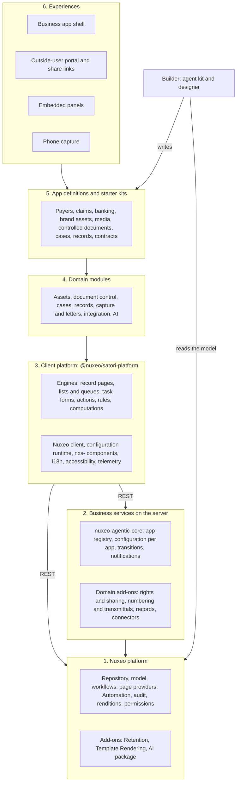
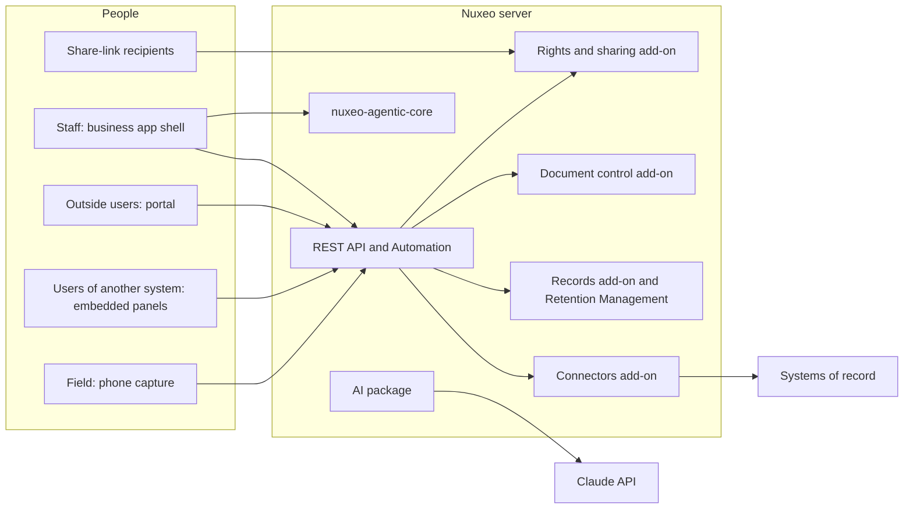
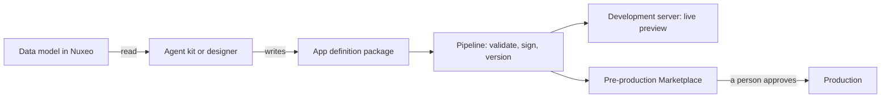

# Architecture for business apps on Nuxeo

How Nuxeo Satori UI becomes one platform that runs a business app for every kind of account: health
payers, insurers, banks, brand teams, media, engineering, operations and records management.

Written on 21 November 2026. It turns the plan in
[presales-business-apps-plan.md](plan.md) (sections 13 and 14) into an
architecture. "Today" statements were checked against this repository and two local Nuxeo 2025
servers with read-only calls; everything else is a proposal, and anything not checked says so.

## The short version

- **One platform, many apps, and an app is data.** A business app is a data model on the server
  plus an app definition: navigation, home, queues, record pages, task forms, actions and rules,
  as a configuration package. Customers do not fork the product to get one.
- **Six tiers, each with one owner and its own release.** The Nuxeo platform; our business
  services on the server; the client platform; optional domain modules; app definitions and
  starter kits; and the experiences people use. The Builder writes app definitions and reads the
  model. The four customisation layers stay, and map onto these tiers (section 5).
- **Generic engines, not screens per customer.** Record pages, lists and queues, task forms,
  actions, rules and computations are engines driven by the app definition. Domain modules
  (assets, document control, records, capture) add widgets and server services to those engines.
- **Five experiences on one platform:** the business app shell for staff, a portal for people
  outside the company (with share links), panels embedded in other systems, a phone capture app,
  and the Builder. Administration is an area of the shell, not another app.
- **Backend: grow what exists, add only what the server must do.** `nuxeo-agentic-core` grows
  into the business services (app registry, configuration per app, allowed transitions,
  notifications). Each domain module that needs enforcement brings a server add-on: rights and
  share links for assets, numbering and transmittals for document control, records extensions,
  connectors to systems of record. No general backend-for-frontend: the apps keep calling the
  Nuxeo REST API, so Nuxeo's permissions stay the control.
- **Delivered in the four waves of the plan's section 14,** wave 1 first: the engines, the asset
  module and its server add-on, the shell with several apps, share links, and the agent kit.

## 1. Goals and constraints

**Goals**

- Any account in the plan's section 13 can get a demo, then a production app, of its own use case
  without product code written for it.
- A presales engineer builds an app's main screens in two days or less, with the agent or the
  designer, and a prospect would accept the result (section 4 of the plan).
- The same app definition runs in demo, pre-production and production, and survives upgrades.
- Every new capability is built once, in the platform, and reused by every kit that needs it.

**Constraints we keep**

- **The server is the control.** Hiding something in configuration is not security
  ([extension reference](../extension-reference.md)). Every check that matters runs on the Nuxeo
  server: permissions, rights on assets, share links, outside users, masking if it becomes real.
- **No free code in configuration.** Rules and computations are registered lists, operations come
  from an allow-list, and configuration only references registered IDs.
- **The data model lives in Nuxeo.** Studio or server code defines types, lifecycles, workflows
  and page providers; the UI reads them and never edits them.
- **Configuration is loaded, not compiled, and lives outside the app bundle,** because
  configuration inside the bundle is destroyed on upgrade (verified fact,
  [AGENTS/11-beta-program.md](../../AGENTS/11-beta-program.md) section 3).
- **Layer 1 stays additive** in the Beta, as already decided ([beta-plan.md](../beta-plan.md)).
- **The repository is public.** No account names and no security findings in documents; those go
  through internal channels.

**Not goals**

- Replacing Nuxeo Studio for modelling, or the Nuxeo server for storage, search, workflow and
  permissions.
- One app per customer in code. A customer's special needs go into configuration first, then a
  plugin (Layer 2), and only then into the platform for everyone.

## 2. Where we start

| Area                  | Today                                                                                                                                                                                                                                              |
| --------------------- | -------------------------------------------------------------------------------------------------------------------------------------------------------------------------------------------------------------------------------------------------- |
| Deployable apps       | `apps/nuxeo-ui`, the product, served by Nuxeo at `/nuxeo/agentic-ui/`; `apps/nuxeo-satori-template`, the forkable template that customer code must be built into; and the end-to-end tests                                                         |
| Libraries             | 9 feature libraries (administration, assets, browse, collections, document-detail, knowledge-discovery, search, tasks, trash); shared UI and the `nxs-` components; the Nuxeo, knowledge and AI clients; the extension registry; app configuration |
| Package for customers | `@nuxeo/satori-platform` 0.2.0 (`libs/platform`), 6 entry points, not published yet                                                                                                                                                                |
| Server code           | `nuxeo-agentic-core`, about 1,560 lines of Java: the configuration servlet, an authentication filter on `/agentic-ui/*`, the login start page and a notification URL codec                                                                         |
| Distribution          | One Marketplace package, `nuxeo-agentic-ui`, for Nuxeo LTS 2025; customer configuration as a separate config package (`tools/satori-generators`) plus presets                                                                                      |
| Configuration         | `bootstrap.json` and `manifest.json`, loaded before sign-in from one namespace per server; layouts from the same servlet. One configuration per server, the same for everyone                                                                      |
| Extension contract    | 13 slots, 14 navigation entries, 31 actions, 6 tabs, 12 columns, 13 `nxs.primitives` components and about 29 `app.rules`, all addressed by registered ID                                                                                           |
| Layouts               | File version 1: sections or tabs of fields; the schema type picks the control. No widgets, computations or related records                                                                                                                         |
| Customer code         | Cannot be loaded into the shipped app: a customer builds the template with their library                                                                                                                                                           |
| Model                 | `ContentModelService` reads types, schemas and facets, but nothing uses it yet                                                                                                                                                                     |
| Already there         | 5 language catalogues with Crowdin and right-to-left support; an accessibility standard; share tokens and outside (`transient/`) users; 12 `AI.*` operations wired but switched off                                                                |
| Not there             | Several apps per server, multi-tenancy, telemetry, web components for embedding, a phone app, an MCP server, a notification centre                                                                                                                 |

On the Nuxeo side, the checks for the plan found that the REST API already gives the content
model, page provider definitions with aggregates, task forms from workflow variables, audit,
comments, bulk actions and ranged downloads ([feasibility report](feasibility.md)).
For this architecture we also checked the modules the new use cases need. Both servers have:

- the `Picture`, `Video`, `Audio` and `PictureBook` types;
- picture views, resizing and recomputation (`Picture.GetView`, `Picture.Resize`,
  `Picture.RecomputeViews`), renditions (`Document.GetRendition`) and conversions (`Blob.Convert`);
- video slicing, joining and closed captions (`Video.SliceInParts`, `Video.Concat`,
  `Video.ExtractClosedCaptions`);
- time-limited permissions and grants to someone outside the company by email
  (`Document.AddPermission` takes `begin`, `end`, `email` and `notify`).

Neither server has retention, legal hold or template operations: those are add-ons.

## 3. The target in one picture



Each tier depends only on the tiers below it. Experiences are thin: each is a shell around the same
client platform, with its own sign-in, routes and allowed modules.

## 4. The tiers

In this document, "us" is the Nuxeo Satori team that owns this repository and its Jira project
(NXSAT). That includes `nuxeo-agentic-core`: a Maven module of this repository, built under
`nuxeo-agentic-ui-parent` and shipped in the Nuxeo Satori Marketplace package. No CODEOWNERS file
records this yet. Because the server tier grows here, with sign-in, configuration and sharing,
naming its owners and a Nuxeo server reviewer should come before wave 1.

| Tier                     | Owns                                                                                      | Owner                                   | Released as                                 |
| ------------------------ | ----------------------------------------------------------------------------------------- | --------------------------------------- | ------------------------------------------- |
| 1. Nuxeo platform        | Storage, model, lifecycles, workflows, search, Automation, audit, renditions, permissions | Nuxeo platform team                     | Nuxeo LTS and its add-ons                   |
| 2. Business services     | What only the server may do for business apps                                             | Us                                      | Marketplace packages                        |
| 3. Client platform       | The engines and the foundations every experience shares                                   | Us                                      | `@nuxeo/satori-platform` on npm             |
| 4. Domain modules        | One kind of work: assets, document control, cases, records, capture, integration          | Us, with the domain's experts           | A platform entry point; an add-on if needed |
| 5. App definitions, kits | One business app: its navigation, home, queues, pages, forms, actions, labels, demo data  | Presales and product (plan, decision 7) | Configuration packages on the Marketplace   |
| 6. Experiences           | Where people work: the shell, the portal, embedded panels, phone capture, the Builder     | Us                                      | Apps built from the client platform         |

**Tier 1, the Nuxeo platform.** Everything above relies on it, as checked: the content model,
page providers with aggregates, task variables, Automation with parameters, the Bulk Action
Framework, audit and comments, picture and video renditions, ranged downloads, and time-limited
permissions. The add-ons each wave needs are named in section 13.

**Tier 2, business services.** Only what must run on the server, because it enforces a rule or
holds a secret. `nuxeo-agentic-core` keeps the runtime essentials: the app registry and the
configuration of each app, the allowed-transitions enricher, and notifications. Each domain module
that enforces something brings its own add-on (section 8), so a customer installs only what its
apps use.

**Tier 3, the client platform.** The engines are where the work goes:

- **Record pages:** layout file version 2, with cards in the main area, named widgets,
  computations, related records with the open record as a parameter, and a page for records that
  are files (preview first).
- **Lists and queues:** any page provider as a list, queue or search form, with typed columns,
  facets, row and bulk actions, and KPIs from aggregates.
- **Task forms:** generated from the workflow step's variables, with field rules and due dates.
- **Actions:** lifecycle transitions as buttons, and allow-listed operations with parameters,
  confirmation and a success message.
- **Rules and computations:** registered lists, evaluated with the open record, the user's groups
  and the selection.
- **Timeline, search and reports, notifications:** shared by every module.

Under the engines: the Nuxeo client, the configuration runtime, the `nxs-` components on Satori,
languages, accessibility, telemetry and the plugin contract. This tier is the published
`@nuxeo/satori-platform`, so a customer's own app is built from the same parts as ours.

**Tier 4, domain modules.** A module adds widgets, record-page sections, actions and
configuration keys to the engines, and declares the server add-on it needs. An app definition
lists the modules it uses. Modules never depend on each other directly: what two of them share
moves into tier 3.

**Tier 5, app definitions and starter kits.** A configuration package per app (section 10). A
starter kit adds the data model (a Studio project or an export), demo data and a demo script.
Kits never ship inside the app bundle.

**Tier 6, experiences.** Section 7.

## 5. The customisation layers across the tiers

The four layers of the customisation contract ([AGENTS/11-beta-program.md](../../AGENTS/11-beta-program.md)
section 2) stay. What grows is what each layer can say.

| Layer                 | Today                                                                        | Target                                                                                                                                                              |
| --------------------- | ---------------------------------------------------------------------------- | ------------------------------------------------------------------------------------------------------------------------------------------------------------------- |
| 0, configuration      | Branding, themes, languages, labels, presets, endpoints                      | Per app as well as per server; labels per language                                                                                                                  |
| 1, declarative wiring | The manifest's `extensions` block over 13 slots and registered IDs, additive | The app definition: record pages (layout v2), queues, home, actions, task forms, rules and computations, still by registered ID and still additive in the Beta      |
| 2, customer code      | An Angular library built into a fork of the template                         | Plugins: signed bundles the shell loads at run time against a versioned plugin API (plan, decision 5). The template stays for changes the plugin API cannot express |
| 3, agent harness      | Skills, generators, guardrails, the Beta harness                             | Plus the MCP server and the app builder skill. The in-app designer writes the same package                                                                          |

A need climbs the layers only when the one below cannot express it: configuration first, then
declarative wiring, then a plugin, and last a change to the platform, which then serves every
account.

## 6. The modules

From the twenty accounts in the plan's section 13. "Today" is this repository and the checked
servers; "Needed by" names use-case groups, not accounts.

### Foundation modules: every app uses them

| Module                         | What it does                                                                            | Tier | Today                                                        | Builds on                                                   |
| ------------------------------ | --------------------------------------------------------------------------------------- | ---- | ------------------------------------------------------------ | ----------------------------------------------------------- |
| Model reader                   | Types, schemas, facets, references, vocabularies, lifecycles, workflows, page providers | 3    | `readContentModel` reads types, schemas and facets           | `/config/types`, `/schemas`, `/facets`, `/search/pp/{name}` |
| Configuration and app registry | Which apps a server has, each app's definition, overlays per customer and tenant        | 2, 3 | One configuration per server, loaded before sign-in          | The configuration servlet                                   |
| Record pages                   | Layout v2, widgets, computations, related records, pages for file records               | 3    | Layout v1                                                    | `/id`, `@children`, enrichers                               |
| Lists and queues               | Page providers as lists, queues and search forms, typed columns, facets, actions, KPIs  | 3    | Three stock page providers                                   | Page providers, aggregates, `Bulk.RunAction`                |
| Task forms                     | Forms from workflow step variables, field rules, due dates                              | 3    | The stock review variables only                              | `taskInfo.schemas`, `Context.StartWorkflow`                 |
| Lifecycle and actions          | Allowed transitions as buttons; allow-listed operations with parameters                 | 2, 3 | No transition actions                                        | `Document.FollowLifecycleTransition`, Automation            |
| Rules and computations         | Group, state, field and user rules; registered computations                             | 3    | Type, facet and permission rules                             | `/me` groups                                                |
| Home and navigation            | A home and a menu per group                                                             | 3    | Four fixed widgets                                           | Aggregates                                                  |
| Timeline and comments          | Audit, comments, workflow and operations on one timeline                                | 3    | Separate pieces                                              | `@audit`, `@comment`                                        |
| Search and reports             | Business search, KPIs and charts with drill-down, scheduled exports                     | 3    | The administrators' analytics page                           | Aggregates                                                  |
| Notifications                  | Notification centre, email on assignment, mentions, digests                             | 2, 3 | Subscribe and unsubscribe                                    | Tasks, audit, `Document.Subscribe`                          |
| Previews                       | Streaming previews of large files                                                       | 3    | The whole file is downloaded first                           | Ranged downloads (206)                                      |
| Languages                      | Interface and labels in the user's language, including model labels                     | 3, 5 | 5 catalogues, Crowdin, right to left; labels in one language | Vocabularies                                                |
| Accessibility                  | WCAG 2.1 AA and Section 508 as the release bar                                          | 3    | A standard exists; conformance not yet shown                 | —                                                           |
| Telemetry and diagnostics      | Screen usage, and "why did my layout not apply?"                                        | 2, 3 | None                                                         | —                                                           |

### Domain modules: an app turns them on

| Module                        | What it does                                                                                                                           | Server part                                        | Today                            | Needed by                                                    | Builds on                                                                      |
| ----------------------------- | -------------------------------------------------------------------------------------------------------------------------------------- | -------------------------------------------------- | -------------------------------- | ------------------------------------------------------------ | ------------------------------------------------------------------------------ |
| Cases                         | Parties, required-documents checklist, timeline, deadlines, related cases                                                              | None                                               | In the prototype                 | Health payers, operations, banking disputes, public agencies | Folderish types, `@children`, workflows                                        |
| Capture and classification    | Inbox for mail, scans and faxes; classify, extract fields, match to a record, create the work                                          | Capture path (platform), AI package                | In the prototype                 | Health payers, insurers, banks, records management           | `AI.Classify`; a capture connector                                             |
| Letters                       | Correspondence from templates, in several languages                                                                                    | Template Rendering (add-on)                        | None                             | Health payers, public agencies, insurers, banks              | `Render.Document` for a basic letter                                           |
| E-signature                   | Signing as a workflow step, the signed file filed on the record                                                                        | A connector (vendor to choose)                     | None                             | Banks, automotive, insurers, public agencies                 | Workflows                                                                      |
| Assets (DAM)                  | Asset pages, renditions, rights and usage, review with pins and timed notes, collections, share links, publishing to channels, AI tags | Rights and sharing add-on                          | In the prototype                 | Brand and product DAM, media                                 | `Picture`, `Video`, `Picture.GetView`, `Document.GetRendition`, `Blob.Convert` |
| Media rights and distribution | Rights by territory and release window, localised versions, delivery packages, watermarks                                              | Rights and sharing add-on                          | None                             | Media                                                        | The assets module, video operations                                            |
| Document control              | Numbering, revisions and supersession, review cycles with comment resolution, transmittals, CAD and BIM viewing, export-control marks  | Document control add-on                            | None                             | Engineering                                                  | Versions, workflows; a partner viewer                                          |
| Records and compliance        | Retention schedules, holds, records declaration, disposition review, physical records, chain of custody, audit export, access logging  | Retention Management (add-on) and a records add-on | None                             | Records management, banks, public agencies, health payers    | Audit                                                                          |
| Outside users and portals     | Invitations, scoped and time-limited access, licensor approvals, supplier and contractor workspaces                                    | Sharing add-on                                     | Share tokens, `transient/` users | Brand DAM, engineering, operations, media                    | `Document.AddPermission` with `begin`, `end` and `email`                       |
| Integration                   | Live data from a system of record on the record page, panels inside other systems, events and webhooks                                 | Connectors add-on                                  | Links by URL template (plan)     | Insurers, banks, automotive, pharmacy                        | Nuxeo events                                                                   |
| AI on the record              | Summaries with related records, classification, extraction into a schema, natural-language search, the agent builder                   | AI package with a Claude provider                  | 12 operations wired, off         | Every group                                                  | `AI.*` operations                                                              |

Rules for adding a module: it has an owner, a configuration schema, a server part only where the
server must enforce or hold a secret, and at least one starter kit that uses it.

## 7. The experiences: which apps we need

Yes, supporting apps are needed: four beside the shell. Each is built from the client platform,
with its own shell, sign-in, routes and allowed modules, so a fix in an engine reaches all of them.

| App                 | For                                                                                     | Built as                                       | Today                             | Wave         |
| ------------------- | --------------------------------------------------------------------------------------- | ---------------------------------------------- | --------------------------------- | ------------ |
| Business app shell  | Staff: every business app, and the Documents app                                        | `apps/nuxeo-ui`, grown                         | The ECM shell, one app per server | 1            |
| Outside-user portal | Licensors, suppliers, contractors, agents, dealers, distributors; share-link recipients | A new app on the same platform                 | Share tokens only                 | 1 (links), 3 |
| Embedded panels     | People working inside a CRM, a core claims system or a bank's front end                 | Web components from the platform               | None                              | 2            |
| Phone capture       | People in the field: claims, moves, inspections                                         | A small progressive web app                    | None                              | 2, 3         |
| Builder             | Presales and administrators                                                             | An agent kit, and a designer area in the shell | Generators and guardrails         | 1, 2         |

**Business app shell.** It hosts several apps on one server. The app registry decides which apps a
user sees, by address or by group, and "Switch app" moves between them. The ECM functions (browse,
search, collections, trash) become the Documents app, which a business app may show or hide; the
nine feature libraries keep working inside it. Administration is an area of the shell: the app
registry, configuration versions and diagnostics, outside users and share links, telemetry, and
tenants for providers. It is served by Nuxeo at `/nuxeo/agentic-ui/`, as today.

**Outside-user portal.** Only what was shared with the person: no Browse, no administration, no
search across the repository. It opens the share links of the assets module without an account,
and signs in invited outside users (section 9). It can live on its own address or network zone,
in front of the same Nuxeo. Licensor approvals, supplier documents and contractor transmittals
are its first flows.

**Embedded panels.** Web components such as a record's documents and actions, a drop zone that
files a document onto a record, and a task list. The host system shows them through its own
extension mechanism and passes a token from its sign-in (section 9).

**Phone capture.** Photos and documents taken in the field, filed onto a claim, a move or an
inspection with the right type and link. It keeps working offline and uploads when back online.

**Builder.** The agent kit is the app builder skill, an MCP server and the existing generators and
config-package tools. It runs in the coding tools presales already use, against a development
server. The designer is the same work for administrators, inside the shell: it writes the same
package, previews it, and publishes only with approval. Neither writes the data model or code. Its
first two slices edit a record page's, an edit form's or a create form's layout file, and a queue,
preview each with its own engine, read-only, and save it as a download; publishing waits for a write
API the app registry does not have ([development plan](development-plan.md), phase 6).

**The template stays.** `apps/nuxeo-satori-template` remains the route for customers who write
Layer 2 code until plugins load at run time, and afterwards for changes the plugin API cannot
express.

## 8. The backend services

Yes, backend services are needed. All but two run inside Nuxeo as add-ons, and none is a general
backend-for-frontend.

| Service                     | Runs in                                                                                             | Does                                                                                                                                                                                                               | Why on the server                                                                                            | Wave    |
| --------------------------- | --------------------------------------------------------------------------------------------------- | ------------------------------------------------------------------------------------------------------------------------------------------------------------------------------------------------------------------ | ------------------------------------------------------------------------------------------------------------ | ------- |
| `nuxeo-agentic-core`, grown | Nuxeo, as today                                                                                     | The app registry; each app's configuration, merged for the customer and tenant and served after sign-in; the allowed-transitions enricher; the notification inbox; telemetry intake                                | A configuration per group or tenant must not be served to anyone; transitions come from the lifecycle policy | 1       |
| Rights and sharing add-on   | Nuxeo                                                                                               | Rights and usage checked on every download, rendition, share and publish; share links with their renditions, watermark, end date, revocation and download log; outside-user invitations; publishing to channels    | The client's check explains a refusal; the server's check is the control                                     | 1, 3, 4 |
| Document control add-on     | Nuxeo                                                                                               | Numbering and revision schemes, supersession, transmittals, comment resolution, export-control marks enforced when sharing                                                                                         | Numbers must be unique, and revisions consistent for every user                                              | 3       |
| Records add-on              | Nuxeo, on Retention Management                                                                      | Disposition review, physical records (locations, barcodes, chain of custody), audit export, access logging for protected data                                                                                      | Retention and holds must hold through every client and the API                                               | 2, 4    |
| Connectors add-on           | Nuxeo; a separate service only where a connector needs its own scaling, network zone or credentials | Live data from a system of record for the record page, cached, with credentials kept on the server; events and webhooks out; fields synced in                                                                      | Credentials, and the other system's access rules, stay on the server                                         | 2       |
| E-signature connector       | Nuxeo, vendor to choose                                                                             | Sends for signature from a workflow step, and files the signed copy and its certificate on the record                                                                                                              | Vendor credentials                                                                                           | 2       |
| AI package                  | Nuxeo (AI package owners)                                                                           | A Claude provider with the official Anthropic Java SDK; extraction into a schema, summaries with related records, classification that finds the record, the content model in natural-language search               | The key stays on the server                                                                                  | 1, 2    |
| Capture path                | The platform: a mail connector or Hyland capture                                                    | Mail, scans and faxes into an inbox folder, where classification takes over                                                                                                                                        | The platform's ingestion path                                                                                | 2       |
| MCP server for the Builder  | Node, beside the developer's tools; never in production                                             | Reads the model, page providers, workflows and operations; validates a package; previews in dev mode; publishes to pre-production                                                                                  | Design time only                                                                                             | 1       |
| Package pipeline            | CI                                                                                                  | Validates every package (schemas, registered IDs, the operation allow-list, the `build.mjs` checks), signs and versions it, publishes it to the Marketplace, and promotes it to production after a person approves | —                                                                                                            | 1       |

**Why no backend-for-frontend.** The experiences call the Nuxeo REST API directly, as today, so
every read and write runs as the signed-in person under Nuxeo's permissions. A layer in between
would have to repeat those permissions or bypass them. The two narrow exceptions are the share
links, whose anonymous visitors reach only the sharing add-on's endpoints, and the connectors,
which call other systems from the server.



## 9. Identity, access and data protection

- **Staff** sign in with the company's single sign-on, as today. Sign-in uses tokens or the
  server's session, never a stored password: a requirement for general availability.
- **Outside users** are invited by email with an end date, as Nuxeo's time-limited grants already
  allow, and see only what was shared with them. How they sign in on LTS 2025 is to be confirmed.
- **Share links** are a token per share, valid only for its assets, renditions and dates, and
  revocable at once. Every download is logged on the asset. A link checks the asset's rights
  again on every download, as the prototype already does.
- **Embedded panels** get a short-lived token exchanged from the host system's sign-in, scoped to
  the panel (decision F in section 15).
- **Authorisation** is Nuxeo's permissions everywhere. Rules in configuration decide only what is
  shown. Rights on assets are checked on the server, and buttons can only run allow-listed
  operations.
- **App definitions** are served after sign-in, by group and tenant, because they describe the
  business: its queues, groups and operations. Only the sign-in page's branding stays public.
- **Protected fields** such as a member's insurance number: masking them on screen is not a
  control. Real protection needs the platform decision recorded in the feasibility report.
- **Access logging** of protected data, for health payers and public agencies, uses the audit and
  is exported by the records module.
- **Tenants**, for providers that serve many client organisations, are separated on the server:
  repository structure, permissions and index. This is to be designed with the platform team; it
  is not checked.
- **AI**: keys stay on the server, data terms are approved before real personal data is sent, and
  a person approves every package the agent proposes to publish.
- **Plugins** loaded at run time are signed, pinned to a version and fetched only from the
  server's plugin registry.

## 10. App definitions and their lifecycle

An app definition is one configuration package. Version 2 of its layout:

```text
app.json                             id, name, version, platform range, groups, address, modules, branding
navigation.json                      menu entries and their rules
home.json                            home cards per group
layouts/<Type>/<mode>.layout.json    version 2: cards, widgets, computations, related records, timeline, comments
queues/<id>.json                     page provider, columns, facets, row and bulk actions, rules
actions.json                         lifecycle buttons and allow-listed operations with parameters
tasks/<workflow>.<node>.layout.json  the task form of each workflow step
labels/<locale>.json                 every label, per language
modules/<module>.json                the settings of each domain module the app turns on
demo/                                demo data and the demo script (starter kits only)
```

- **Validated before it ships:** JSON schemas for every file, registered IDs, the operation
  allow-list and the platform range. A mistake fails the build, not a user's screen.
- **Overlays:** starter kit, then customer, then tenant, then environment, merged on the server in
  that order. The app registry serves the result. As built on 27 November 2026, a later file
  replaces an earlier one whole, and only labels combine key by key; patch overlays are proposed in
  [extension-model.md](extension-model.md) (decision L).
- **Versions:** each package has a semantic version and declares the platform range it needs. The
  shell refuses an app it cannot run, with a clear message, rather than drawing half of it.
- **Where it lives:** contributed to the configuration extension point
  (`org.nuxeo.agentic.ui.config`) by a Marketplace package, never inside the app bundle, which
  upgrades replace.



## 11. Deployment

| Topology                   | What runs                                                                                                                                                             | For                                       |
| -------------------------- | --------------------------------------------------------------------------------------------------------------------------------------------------------------------- | ----------------------------------------- |
| One customer, several apps | Nuxeo with the shell (`nuxeo-agentic-ui`), `nuxeo-agentic-core`, the domain add-ons its apps use, and one configuration package per app                               | Most accounts                             |
| With outside users         | The above, plus the portal on its own address, and its own network zone where required, in front of the same Nuxeo. Share-link endpoints are rate-limited at the edge | Brand DAM, media, engineering, operations |
| Embedded                   | The web components served by the Nuxeo server at a versioned address; the host system loads them and supplies a token; a content security policy on both sides        | Insurers, banks, automotive, pharmacy     |
| Many client organisations  | Tenants separated on the server, with an app registry overlay per tenant; to be designed with the platform team                                                       | Records management providers              |
| Demo and presales          | A demo server per kit, or one with several apps; dev mode on for the live preview; demo data that resets                                                              | Presales                                  |

## 12. Cross-cutting concerns

- **Languages.** The 5 catalogues, Crowdin and right-to-left support stay. App definitions get
  labels per language, model labels come from vocabularies, and letters can be sent in several
  languages. Translations were out of the Beta; they return with wave 2 (Spanish, the Nordic
  languages) and wave 3 (French).
- **Accessibility.** WCAG 2.1 AA and Section 508 are the release bar for business screens. The
  engines carry them, so every app inherits them, and the designer flags a missing label in
  configuration.
- **Scale.** Queues and libraries over millions of records page and aggregate on the server.
  Never count past what the server reports: `resultsCount` is -2 beyond one page, and NXQL search
  lags behind writes (verified facts), so a screen refreshes a record from the document, not from
  search. Large media and drawings stream. Bulk actions run over a whole query through the Bulk
  Action Framework.
- **Observability.** Telemetry of screens and actions without personal data, the configuration
  diagnostics page, and errors that name the app and the package version.
- **Testing and evidence.** Each kit's demo script runs as end-to-end tests. The engines get
  contract tests over configuration. Every package passes the existing gates (lockfile,
  guardrails, lint, test, build, typecheck), and a gate counts as evidence only once it has been
  seen failing on purpose.
- **AI governance.** An effort level and a structured output per operation, refusal handling, a
  spending cap, and a person approving whatever the agent publishes.

## 13. Delivery by wave

The waves of the plan's section 14, and what each tier delivers in them.

| Wave                                    | Starter kits                                          | Business services (tier 2)                                                          | Client platform (tier 3)                                                                                                             | Domain modules (tier 4)                                                                      | Experiences (tier 6)                                                            | From others                                                                     |
| --------------------------------------- | ----------------------------------------------------- | ----------------------------------------------------------------------------------- | ------------------------------------------------------------------------------------------------------------------------------------ | -------------------------------------------------------------------------------------------- | ------------------------------------------------------------------------------- | ------------------------------------------------------------------------------- |
| 1. Prove both shapes                    | Payers and claims; brand assets                       | App registry and configuration per app; allowed transitions; rights and share links | Layout v2 and record pages, including pages for files; lists and queues; task forms; actions; rules and computations; home per group | Cases; assets                                                                                | The shell with several apps; the share-link view; the agent kit and MCP server  | The Payers model and demo data (presales); a Claude provider in the AI package  |
| 2. Records that live elsewhere          | Property and casualty claims; onboarding and disputes | Connectors; retention and holds; e-signature                                        | Labels per language (Spanish, Nordic); notification centre; search and reports                                                       | Integration; capture and classification; letters; e-signature; records (retention and holds) | Embedded panels; phone capture; the designer's record, queue and action screens | Retention Management; Template Rendering; a capture path; an e-signature vendor |
| 3. Outside people, controlled documents | Controlled documents; case management                 | Outside-user invitations; numbering, revisions and transmittals                     | French; streaming previews for large drawings                                                                                        | Outside users and portals; document control                                                  | The full outside-user portal; phone capture for operations                      | A CAD and BIM viewer; confirmation of how outside users sign in                 |
| 4. Media rights, records at scale       | Media assets and rights; records management           | Rights by territory and window; disposition and physical records; tenants           | —                                                                                                                                    | Media rights and distribution; records and compliance                                        | Tenant administration                                                           | Video conversion on customer servers; a tenancy design with the platform team   |

## 14. Changes to this repository

- **Apps.** `apps/nuxeo-ui` grows into the shell: app registry, Documents app, administration
  area. New: `apps/nuxeo-portal` for outside users and share links, `apps/nuxeo-capture` for the
  phone, and a build that produces the web components. `apps/nuxeo-satori-template` stays.
- **Engine libraries.** Under `libs/shared/`, grown from what exists: record pages from
  `document-layouts`, the configuration runtime from `app-config`, rules from `extensions`; and new
  ones for lists and queues, task forms, actions and computations.
- **Module libraries.** Under `libs/modules/<name>`: assets, sharing, cases, capture, letters,
  document control, records, integration. Each has its configuration schema and its Storybook
  stories.
- **Boundaries.** New tags in `eslint.config.mjs` (`scope:engine`, `scope:module`,
  `scope:experience`) with the rule: experiences may use modules, modules may use engines, and
  modules never use each other. **In place since 22 November 2026**, with these tagging rules:
  - an engine carries `scope:shared` as well as `scope:engine`, because it is tier 3 and lives in
    `libs/shared/`;
  - a module carries `scope:module` and a type tag, and only an app may use it;
  - an experience carries `scope:experience`, and may not use the current app's features. That is
    why `apps/nuxeo-ui` takes the tag only as its features become modules and engines.

  Three engines carry `scope:engine` so far, `libs/shared/computations`, the record page's
  `libs/shared/document-layouts` and the home's `libs/shared/home`, and all three import only shared
  code. No module or experience exists before phase 1, so lint has no forbidden
  import to fail on, and `npm run beta:module-boundaries` proves the rules in CI. It lints imports
  between probe projects that carry each tag, with the real rule: 14 forbidden imports reported,
  7 allowed ones quiet. Eight of the forbidden ones keep decision 5's plugin spike,
  `tools/plugin-spike`, out of every app, library and package
  ([the spike](spikes/plugins-decision-5.md)).

- **Packages.** The engines and the domain modules ship in one package, `@nuxeo/satori-platform`.
  Each module is its own entry point (`@nuxeo/satori-platform/modules/<name>`), so an app built
  from the template bundles only the modules it imports. Each module's server add-on is still its
  own Marketplace package (decision B). This is decision A, as taken on 22 November 2026.
- **Server.** `nuxeo-agentic-core` grows. Each add-on is a Maven module with its own Marketplace
  package, beside the existing three modules of `pom.xml`.
- **Tools.** The MCP server under `tools/`; the app builder skill under `.cursor/skills/`,
  mirrored with `npm run mirror:agents`; the JSON schemas of the app definition in one place that
  the pipeline, the designer and the agent all read.

## 15. Decisions needed

From the plan's section 9, these gate the build: reopening the Beta scope (workflow and business
records, decision 2), buttons bound to Automation chains (3), how small the declarative
expression set for layouts stays (4), loading customer code at run time (5), and who owns the
starter kits (7).

Decision 4 was taken on 22 November 2026 for engineering: registered computations and rules
only, with no expression language. The security review of the starting set is still open, and
must be done before phase 1 ends ([decision log](decisions.md)).

This architecture adds:

- **A. Packages: decided on 22 November 2026.** One package, `@nuxeo/satori-platform`, with each
  domain module as its own entry point. This replaces the first recommendation here, a package
  per module, which was made before two things were checked:
  - how the app reaches customers. Most get the prebuilt app in `nuxeo-agentic-ui`, which carries
    every module either way;
  - what each published package costs. Each needs the five publication gates (API surface,
    publishability, installing without GitHub Packages, fork simulation, upgrade rehearsal) and a
    version matrix with the platform.

  A module moves into a package of its own when it needs its own release cadence or licence. The
  module boundary rules keep each one separable, so that move stays mechanical.

- **B. Server add-ons:** `nuxeo-agentic-core` for the runtime essentials and one add-on per domain
  module (recommended), or one large add-on.
- **C. Outside users:** whether they are in the Beta scope, and how they sign in.
- **D. Connectors:** inside Nuxeo as an add-on (recommended), or as a separate integration service.
- **E. App definitions after sign-in:** served by group and tenant instead of anonymously, which
  changes how configuration loads today (before sign-in).
- **F. Tokens:** token-based sign-in for the shell, and token exchange for the embedded panels.
- **G. Tenancy:** how providers keep client organisations apart.
- **H. Vendors:** the e-signature service, and the CAD and BIM viewer, to support first.
- **I. Protected fields:** the platform decision recorded in the feasibility report.

## 16. Risks

- **Scope.** Eight groups and about twenty-five modules could stall everything. Engines come
  first, in waves, and a module enters the platform only with a starter kit that uses it.
- **Platform coverage.** The shell targets Nuxeo LTS 2025, and the add-ons it needs (Retention
  Management, Template Rendering) are not installed by default.
- **Two front ends.** The shell and the portal share one platform, and the portal keeps a small
  surface.
- **Configuration that turns into a programming language.** Registered lists, schemas and
  allow-lists keep it declarative: no code in configuration.
- **Scale.** Media libraries and records providers hold millions of records. Measure with
  realistic volumes in wave 1, not at the end.
- **New surfaces.** Share links, outside users, embedded panels and plugins each get an
  independent security review before they go live.
- **The public repository.** No account names or security findings in documents.

## 17. Not checked

- How outside users invited with `Document.AddPermission` and an email sign in on LTS 2025.
- Video conversion on customer servers: the operations exist on both of our servers.
- Tenancy support in the platform.
- A read permission per field.
- Vendors for e-signature and for CAD and BIM viewing.
- Whether the configuration servlet can serve each app's definition after sign-in without
  changing the order in which the app starts.
- Web components carrying the Satori theme inside another system's page.
- Loading plugins at run time with Angular 22: not prototyped.

Related: the [plan](plan.md), the
[feasibility report](feasibility.md), and the
[clickable prototype](https://nuxeo.github.io/Nuxeo-Satori-UI/prototypes/business-apps/).
