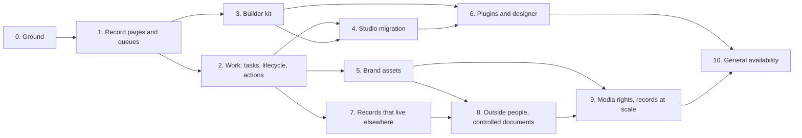

# Development plan: business apps for every account

The phased plan that builds the [architecture](architecture.md), from foundations to general
availability. Each phase ends in a demo the team can watch on a shared server.

Status, 24 November 2026, on `staging/enterprise-grade-app`, which reaches
`integration/enterprise-grade-app` in one reviewed pull request: **no phase is done by its own
"Done when".** Each still needs a decision, a shared server, real packages or people outside the
team. Every decision in the [decision log](decisions.md) is still open; where code was built against
a recommendation, the log's notes say so. Estimates are a first pass, to refine with the people who
will do the work.

| Phase           | Built                                                                                                                                                                                                                                               | Not done yet                                                                                                                                                                                                                                         |
| --------------- | --------------------------------------------------------------------------------------------------------------------------------------------------------------------------------------------------------------------------------------------------- | ---------------------------------------------------------------------------------------------------------------------------------------------------------------------------------------------------------------------------------------------------- |
| 0. Ground       | The schemas for app definition version 2; the library boundaries (`scope:engine`, `scope:module`, `scope:experience`); the pipeline's validation and version rules; the app registry and "Switch app", on B's and E's recommendations; migration M0 | Every decision. Signing, and publishing to pre-production, are a proposal ([package-pipeline.md](package-pipeline.md), section 9). No CODEOWNERS file. No shared demo server. The Payers model is a stand-in, and no real Studio package has arrived |
| 1. Record pages | Layout version 2 with related lists; queues, the home, the menu and labels; the Payers kit's four pages, three queues, home and demo users                                                                                                          | The kit's demo script passes 37 of 37, on a local server and the stand-in model, not a shared server. The one-day rebuild is not run. The social security number is left out for adjusters, not masked: decision I                                   |
| 2. Work         | Task forms; lifecycle buttons, with the allowed-transitions enricher; bulk actions over a whole query; the timeline and comments; a first notification centre                                                                                       | Operation buttons (decision 3); the claims and appeals kits and their workflow; the acceptance test; the security review                                                                                                                             |
| 3. Builder kit  | The MCP server, with a preview; the app builder skill; the version 2 generators; package versions; a second kit, [contracts](../../business-apps/packages/contracts-demo/README.md), built with the skill                                           | Signatures and promotion; the outside builder's day; Claude seats; the contracts kit installed, seeded and seen live                                                                                                                                 |
| 4. Migration    | Migrations M1 and M2: the converter and the harness's checks, with their negative controls; the report, and a decisions file for each reported item's owner and decision                                                                            | Three real packages, the lab server, accepting proposals, and a reviewer for each report                                                                                                                                                             |
| 5. Brand assets | A picture's asset page with its views, and banners on its rights end date; the brand assets kit's first version: the asset and product pages, the library with its facets, a stand-in model and a seed, built by the pipeline                       | The kit installed on a server and its demo run: its asset page is seen only in dev mode, on the platform's own Pictures. Video, review, share links (decision C), rights the server enforces                                                         |
| 6. Designer     | A first slice of the designer: an administrator opens a record page's layout file, reorders, hides and adds fields, renames a card, previews it on a real record with the record page engine, and downloads it once the validator finds nothing     | Plugins (decision 5, open: no customer code is loaded). Publishing and its approval step: the app registry has no write API. Queues and actions in the designer. The byte-for-byte round trip                                                        |
| 7. Elsewhere    | The connectors add-on's first slice, on D's recommendation: `Connector.Read`, a stand-in core system, and layout version 2's `external` card ([README](../../nuxeo-agentic-connectors/README.md))                                                   | Installed nowhere: its demo has not run on a server. Its security review. Caching, events and webhooks, a real connector, embedded panels (decision F), capture, e-signature, letters, retention and the languages                                   |
| 8 to 10         | Nothing                                                                                                                                                                                                                                             | Everything                                                                                                                                                                                                                                           |

This status does not check phase 0's end-to-end required check or its agreement with the Beta team.

## The short version

- **Eleven phases, numbered 0 to 10, in three tracks.** The engines and starter kits, one use
  case at a time; the Builder and the Studio migration; and quality, which runs throughout and
  closes with general availability.
- **Every phase ends in a demo day.** It runs live on a shared demo server, from packages the
  pipeline built, following a written script with fictional data, and is recorded for people who
  miss it.
- **Every account gets a demo of its own use case** by the end of phase 9, group by group:
  - health payers and public agencies in phase 2;
  - any account running Web UI configured in Studio sees its own screens migrated in phase 4;
  - brand and product teams in phase 5;
  - insurers and banks in phase 7;
  - engineering and operations in phase 8;
  - media and records management in phase 9.
- **The first demo** of the new app on a real model comes at the end of phase 1, about nine weeks
  in. The plan's acceptance test, the Payers screens rebuilt in two days with no Angular code,
  closes phase 2.
- **General availability** is about 50 weeks away with three tracks working in parallel, or
  about 65 weeks if one team does everything in order. This is a first estimate.

## 1. How every phase works

- **One goal, one demo.** Each phase states what it builds, the demo that shows it, when it is
  done, what it needs from others, and its risks.
- **Demoable means:**
  - it runs on the shared demo server, not a laptop;
  - it is installed from packages the pipeline built;
  - it follows the starter kit's written demo script;
  - it uses fictional data only.
- **Done means all of these:**
  - the demo is accepted by the product owner and the presales lead;
  - the repository's gates are green: lockfile, guardrails, lint, test, build, typecheck;
  - the demo script passes as an end-to-end test;
  - every new gate has been seen failing on purpose;
  - an independent adversarial review is done, as this repository requires before any phase is
    signed off;
  - the evidence is filed outside the repository, and the docs are updated.
- **Advisory checks wait for phase 10.** Until the plan is implemented, SonarCloud, the
  accessibility checks and the security scans run on every pull request, but nobody chases them:
  no phase waits for them or fixes what they report, and phase 10 brings them back to green
  before the final pull request to `main` ([decision log](decisions.md), 22 November 2026). The
  one that still blocks is CodeQL: the branch's ruleset stops a merge with a high-severity
  finding.
- **No phase starts without its inputs** (section 6). Missing inputs are escalated in the phase
  before.
- **Each phase updates the scoreboard**, the prototype's "Every account" page, and the coverage in
  section 5.

## 2. Team and environments

**Squads**, a proposal to confirm in phase 0:

| Squad                 | Works on                                                        | Tiers         |
| --------------------- | --------------------------------------------------------------- | ------------- |
| Engines               | Record pages, lists and queues, task forms, actions, rules      | 3             |
| Server                | `nuxeo-agentic-core` and the add-ons                            | 2             |
| Modules and kits      | Domain modules and starter kits, with presales                  | 4, 5          |
| Builder and migration | The MCP server, the agents, the migration harness, the designer | 6 and tooling |
| Quality               | Test automation, performance, accessibility, security reviews   | All           |
| Design                | Satori-based screens and their states                           | 3, 4, 6       |

They are supported by a product owner, a presales lead and a security reviewer. The estimates
assume about twelve people, Nuxeo LTS 2025 only, and inputs on time.

**Environments:**

- **Development servers**, one per squad, with the Satori package and dev mode on.
- **Shared demo servers**, one per use case as it arrives: Payers, brand assets, the migration lab
  (a Studio package with Web UI and the new app side by side), and then insurance, engineering
  and records.
- **Storybook on GitHub Pages**, for every new component and module.
- **The clickable prototype**, which stays the reference for intent.
- **The evidence folder** outside the repository, for screenshots, recordings and reports.

## 3. The phases at a glance

| Phase | Name                                 | The team sees                                                                                                        | Groups with their first demo                      | Estimate                |
| ----- | ------------------------------------ | -------------------------------------------------------------------------------------------------------------------- | ------------------------------------------------- | ----------------------- |
| 0     | Ground                               | The pipeline refuses a broken app and ships a valid one; the shell lists two apps from the registry                  | —                                                 | 3 weeks                 |
| 1     | Record pages and queues              | The Payers home, queues and record pages drawn from configuration on the real model                                  | Health payers, public agencies (a first look)     | 6 weeks                 |
| 2     | Work: tasks, lifecycle, actions      | A claim determined, approved by a supervisor and paid; the two-day acceptance test                                   | Health payers, public agencies (3 accounts)       | 5 weeks                 |
| 3     | The Builder kit                      | A presales engineer builds and publishes an app with the agent, live                                                 | — (every account, as the way kits are built)      | 4 weeks, beside phase 2 |
| 4     | Studio migration                     | A real Studio project converted, Web UI and the new app side by side, the harness report, a broken conversion caught | Every account on Web UI with Studio               | 6 weeks                 |
| 5     | Files as records: brand assets       | The brand assets flow on real pictures and video, rights refused by the server, share links                          | Brand and product DAM (4 accounts)                | 6 weeks                 |
| 6     | Plugins and the designer             | A custom element running as an Angular plugin; an administrator changes a layout and publishes it                    | — (every account with custom code)                | 5 weeks                 |
| 7     | Records that live elsewhere          | A claim with live core-system data, a panel inside a CRM, a scanned letter filed by itself, an e-signature           | Insurers (4), banks (2), pharmacy capture         | 8 weeks                 |
| 8     | Outside people, controlled documents | A transmittal to an outside contractor through the portal, a licensor approval, a photo from a phone                 | Engineering (2), operations (2), licensed apparel | 8 weeks                 |
| 9     | Media rights, records at scale       | A film delivered within its window, a disposition with approval, two client organisations kept apart                 | Media (1), records management (1)                 | 8 weeks                 |
| 10    | General availability                 | A release candidate across all kits, an upgrade that keeps every configuration, self-service migration               | All 20 accounts, by group                         | 6 weeks                 |

**Tracks:**

- **Engines and kits:** phases 1, 2, 5, 7, 8 and 9.
- **Builder and migration:** phases 3, 4 and 6.
- **Quality:** every phase, then phase 10.

Phases on different tracks overlap: phase 3 runs beside phase 2, phase 4 beside phase 5, and
phase 6 beside phase 7.

## 4. The phases

### Phase 0. Ground (3 weeks)

**Goal.** Take the decisions and lay the skeleton, so that phases 1 to 3 start without
arguments.

**Builds:**

- The decisions phase 1 needs, recorded in the [decision log](decisions.md): reopening the Beta
  scope, operation buttons, the expression set, the packages (A), the server add-ons (B), app
  definitions after sign-in (E, which reopens parity decision 4), and tokens (F).
  - **Already taken:**
    - where the work is built: on `integration/enterprise-grade-app` (decision J);
    - the expression set (decision 4): registered computations and rules only, with its security
      review still to come;
    - the packages (A): one package, with an entry point per module.
- An agreement with the Beta team on the Beta phases still in progress, configuration and the
  registry, which the engines grow from.
- The current app's end-to-end flows as a required check on every pull request, so business apps
  work cannot change the current app unnoticed.
- A CODEOWNERS file naming the owners of `nuxeo-agentic-core` and of each new library.
- The new library boundaries (`scope:engine`, `scope:module`, `scope:experience`) in
  `eslint.config.mjs`, with a test that a forbidden import fails.
- JSON schemas for app definition version 2: `app.json`, layouts, queues, actions, task forms,
  labels and modules.
- The package pipeline's first stage: validate, sign, publish to pre-production.
- The app registry's first version in `nuxeo-agentic-core`: two app definitions, served after
  sign-in.
- The Payers demo server, with the Satori package and dev mode on.
- Migration M0: the catalogue of Studio slots and elements, the theme token map, and the harness
  skeleton with its negative controls.

**Demo:**

1. Push an app definition with an unknown widget. The pipeline fails and names the widget.
2. Fix it. The pipeline passes and publishes the package to pre-production.
3. Open the shell on the demo server. "Switch app" lists the two apps from the registry.
4. Run the migration harness on a deliberately broken conversion of the sample Studio package. It
   fails, and says why.

**Done when:**

- the decisions are recorded with their owners;
- every new gate has been seen failing;
- the demo server is up;
- the inputs below have arrived.

**Needs:**

- the Payers model and demo data (presales);
- at least two real Studio packages (presales and customers);
- a demo server with the Satori package (platform);
- the use case of the account nobody has placed yet (presales).

**Risks:** a late decision delays every later phase. App definitions served by group conflict with
parity decision 4, which has to be reopened in this phase.

### Phase 1. Record pages and queues (6 weeks)

**Goal.** The Payers records and work lists, drawn entirely from configuration, on the real
Payers model.

**Builds:**

- **Engines:** layout version 2 (cards, the widget registry, the computation registry, related
  records, read-only rules); record pages for types with no file; the model reader on
  `ContentModelService`; lists and queues over page providers, with typed columns, facets, sorts
  and row actions; a home per group, with cards that carry rules.
- **Server:** the app registry and each app's configuration in `nuxeo-agentic-core`.
- **Kit:** Payers version 0: the Member, Claim, Case and Provider pages, three queues, and a home
  for two groups.

**Demo:**

1. Sign in on the Payers demo server as an adjuster: a home with KPIs from aggregates.
2. Open a queue.
3. Open a member: age, combined address, and the member's claims and cases, matching the Web UI
   screenshot from the presales feedback.
4. Switch to member services: the protected fields are masked on screen.
5. Show the layout file behind the page: no Angular code.

**Done when:**

- a presales engineer rebuilds the Member page from an empty package in one day or less (the first
  half of the acceptance test);
- the kit's demo script passes end to end.

**Needs:** the Payers model (phase 0).

**Groups:** health payers and public agencies, as a first look.

### Phase 2. Work: tasks, lifecycle and actions (5 weeks)

**Goal.** Claims work end to end, driven by the workflow and lifecycle on the server.

**Builds:**

- task forms from each step's variables (`taskInfo.schemas`), with field rules;
- the allowed-transitions enricher in `nuxeo-agentic-core`, and lifecycle buttons;
- buttons that run allow-listed operations, with parameters, confirmation and a success message;
- bulk actions over a whole query (the Bulk Action Framework);
- the timeline and comments;
- a first notification centre;
- the claims and appeals kits.

**Demo:**

1. An adjuster approves a claim over $5,000: it goes to the supervisor.
2. The supervisor approves it, and the claim moves to Approved.
3. Deny another claim without a reason: the field rule stops it.
4. "Request medical records" runs a server chain.
5. The supervisor updates every result of a queue in one action.
6. Open an appeal case with its checklist and timeline.

**Done when:**

- the plan's acceptance test passes: a presales engineer rebuilds the Member, Claim and Case screens
  with no Angular code in two days or less, and a prospect would accept the result;
- the security review of operation buttons is done.

**Needs:**

- the Studio chains behind the buttons (presales);
- decisions 2 and 3.

**Groups:** health payers and public agencies (3 accounts). The pharmacy's prior-authorisation
faxes wait for capture, in phase 7.

### Phase 3. The Builder kit (4 weeks, beside phase 2)

**Goal.** Presales builds and changes an app with an agent, safely.

**Builds:**

- **The MCP server:** reads the model, page providers, workflows, vocabularies and operations
  with their parameters; validates a package; previews it in dev mode; publishes to
  pre-production. The reads, the validation and the preview, on the local development server, are
  in [`tools/builder-mcp`](../../tools/builder-mcp/README.md); publishing is not built yet.
- **The app builder skill**, written under `.cursor/skills/` and mirrored. It is
  [`.cursor/skills/app-builder/SKILL.md`](../../.cursor/skills/app-builder/SKILL.md), and says
  which of its steps are not built: publishing is a person's tag.
- **The generators**, updated for app definition version 2: `app-package`, `app-layout`,
  `app-form`, `app-queue`, `app-action`, `app-registry` and, for a demo's stand-in model,
  `app-model`, in [`tools/satori-generators`](../../tools/satori-generators). A record page and a
  form are laid out from the type's schemas in a content model, from a file or read live; the
  component contributes each, and the app to the app registry with every file it serves. Their
  specs hold a scaffold, and a demo kit written by the generators but for its home, menu and task
  form, to the package pipeline: each passes, given the model and an allow-list for its operation,
  and broken copies are refused.
  They are internal: they write packages this repository's pipeline checks.
- **The pipeline**, completed: versions, signatures, and promotion after a person approves.
  Versions are built ([package-pipeline.md](package-pipeline.md), section 8): a version that did
  not move as far as the changes need is refused, and each build writes what changed. Signatures
  and promotion are a proposal there, section 9, for the user to decide.

**Demo:**

1. On a development server, a presales engineer asks the agent for a contracts app.
2. The agent writes the package and runs the checks.
3. The app appears in the live preview.
4. The engineer asks for a field rule in plain words.
5. The agent publishes to pre-production, and the package installs on the demo server.

**Done when:**

- someone outside the team builds a small app with the agent in a day (the tutorial in the plan's
  section 7);
- every write by the agent passes validation;
- an agent asked to use an unregistered ID is refused.

**Needs:**

- Claude seats approved under Hyland's AI use requirements;
- a development server with the Satori package.

### Phase 4. Studio migration (6 weeks)

**Goal.** A customer's Web UI Studio project moves to the new app, with proof. Details in the
[migration document](studio-migration.md), phases M1 and M2.

**Builds:**

- the inventory agent and the deterministic converter, covering layouts, search screens, slots,
  the dashboard, the theme, translations, task forms, tabs, layout blocks, structured conditions
  and the known JavaScript patterns;
- harness checks 1 to 8 and 10, with truth tables;
- the report;
- the migration lab server.

**Demo:**

1. Hand over a real Studio package.
2. The inventory: counts, and the quirks found.
3. The converted package.
4. The harness: Web UI and the new app side by side on the same documents; matching request logs;
   the truth tables.
5. The report: 100% of the package accounted for, every reported item with an owner.
6. A mutated conversion fails.
7. Install the migrated package beside Web UI: users move between both on the same server.

**Done when:**

- three real packages are migrated with every automatic check green;
- the negative controls fail as expected;
- a reviewer approves each report.

**Needs:**

- at least three real Studio packages, including conditions, task layouts and several languages;
- a server where each runs with Web UI.

**Groups:** every account that runs Web UI configured in Studio. Which accounts that covers is to
be confirmed account by account in phase 0.

### Phase 5. Files as records: brand assets (6 weeks)

**Goal.** Prove the file-first shape, on real pictures and video.

**Builds:**

- **The assets module:** asset pages; the library as a grid with filters; renditions through
  picture views and `Document.GetRendition`; video preview with timed notes; review with pins and
  rounds; product pages with their required shots.
- **The rights and sharing add-on:** rights enforced on download, rendition, share and publish;
  share links with their renditions, watermark, end date, revocation and download log; publishing
  to channels.
- **The brand assets kit**, for the fictional Acme Outdoor of the prototype.

**Demo:**

1. The prototype's brand assets flow, on a real server: a rights-ending banner on a live asset.
2. The print rendition is refused, then refused again when the REST API is called directly: the
   server enforces it.
3. A share link opened in a private window, watermarked. Revoke it, and the link stops working.
4. A creative review with pins on the picture.

**Done when:**

- a presales engineer rebuilds the product and asset pages in two days or less (the plan's second
  acceptance test);
- a library of 100,000 synthetic assets stays within the performance budget;
- the share links' security review is done.

**Needs:**

- decision C, for share links;
- picture and video conversion on the demo server.

**Groups:** brand and product DAM (4 accounts). Licensor approvals come with the portal, in
phase 8.

### Phase 6. Plugins and the designer (5 weeks)

**Goal.** What configuration cannot say becomes a safe plugin, and administrators change apps
without the agent.

**Builds:**

- migration M3, the code track: custom elements to Angular plugins, with harness check 9;
- plugin loading, as decision 5 sets it: run-time loading after a spike, or the template build;
- the designer in the shell: record layouts, queues and actions, written to the same package, with
  preview and an approval step before publishing;
- the runtime slots that customer demand calls for, from Studio's 24.

**Demo:**

1. A custom element from a real package runs as an Angular plugin, with its parity report.
2. An administrator adds a field in the designer, previews it, gets it approved, and publishes it.
3. The designer's output matches the hand-written JSON byte for byte.

**Done when:**

- two custom elements are migrated and pass check 9;
- plugin loading is chosen, signed and pinned;
- the designer's round-trip tests pass.

**Needs:**

- decision 5;
- real packages with custom elements.

**Built so far** ([`libs/features/layout-designer`](../../libs/features/layout-designer/README.md)):
the designer's first slice, for record pages only, at `/#/administration/layout-designer`.

- **What it does:** it opens a record page's `view` file as the server serves it. It reorders and
  hides fields, adds a property of the type, and changes a card's id, heading text and heading key.
  The record page engine draws each change, read-only, on a real record of the type.
- **What it checks:** the validator checks every change, and the file is downloaded only when it
  finds nothing. The file is held to the server's content model when the model can be read; when it
  cannot, the page says so and makes every other check, as the pipeline does without `--model`.
- **Publishing is out of its scope.** It needs a write API the app registry does not have yet, so
  the file is downloaded, for a package or for `npm run config:dev`, and nothing is written to the
  server.
- **No plugin and no customer code:** decision 5 is open.
- **Only administrators see the page, and that is not a security control:** the server's
  permissions decide what anyone may read or change.

### Phase 7. Records that live elsewhere (8 weeks)

**Goal.** Insurers and banks see their core-system data beside their documents, and their mail
files itself.

**Builds:**

- the connectors add-on (live data on the record page, caching, credentials on the server, events
  and webhooks), with a mock core system and one real connector chosen with presales;
- embedded panels: web components, and token exchange with the host;
- the e-signature step;
- capture and classification: mail into an inbox, then classify, extract into a schema and match
  to the record, through the AI package's Claude provider;
- letters through Template Rendering;
- retention and holds through Retention Management;
- Spanish and the Nordic languages;
- the kits for property and casualty claims, and for onboarding and disputes.

**Demo:**

1. A property claim with live policy and payment data from the core system, beside its photos and
   documents.
2. The same panel inside a CRM page.
3. A scanned claim letter classified, its fields extracted, and filed on the claim.
4. An onboarding case: KYC checklist, e-signature, the signed file filed.
5. A legal hold blocks a deletion, on the server.
6. The app in Spanish.

**Done when:**

- the claim page is rebuilt with the agent in two days or less;
- the connectors' security review is done;
- the AI data terms are approved before any real data is sent.

**Needs:**

- Retention Management and Template Rendering on the demo server;
- a capture path;
- an e-signature vendor;
- the Claude provider in the AI package;
- decisions D and F.

**Groups:**

- insurers (4 accounts);
- banks (2 accounts);
- the pharmacy's prior-authorisation capture.

### Phase 8. Outside people, controlled documents (8 weeks)

**Goal.** Work that crosses company lines, and documents that must stay under control.

**Builds:**

- **The outside-user portal:** invitations with an end date through `Document.AddPermission`,
  licensor approvals, supplier and contractor workspaces.
- **The document control add-on:** numbering; revisions and supersession; review cycles with
  comment resolution; transmittals; export-control marks.
- **A CAD and BIM viewer**, from a partner.
- **French.**
- **The phone capture app.**
- **Kits** for controlled documents, and for case management: vehicle deals and titles, moves and
  damage claims.

**Demo:**

1. An engineer issues a transmittal to an outside contractor.
2. The contractor signs in to the portal, comments, and returns it.
3. The new revision supersedes the old one.
4. A licensor approves artwork in the portal.
5. A driver photographs damaged goods on a phone, and the photo is filed on the claim of the move.
6. The app in French.

**Done when:**

- the transmittal flow passes end to end;
- the outside users' security review (sign-in, scope, expiry) is done;
- document numbers stay unique under concurrent users, in a load test.

**Needs:**

- decision C;
- a CAD and BIM viewer vendor;
- confirmation of how outside users sign in on LTS 2025.

**Groups:**

- engineering (2 accounts);
- operations (2 accounts);
- licensed apparel, within brand and product DAM.

### Phase 9. Media rights, records at scale (8 weeks)

**Goal.** The most demanding rights, and the largest repositories.

**Builds:**

- **Media rights and distribution:** territories, release windows, localised versions, delivery
  packages, watermarks.
- **The records add-on:** disposition review; physical records with locations, barcodes and chain
  of custody; audit export; access logging.
- **Tenancy**, designed with the platform team.
- **Performance work**, for millions of assets and records.
- **Kits** for media assets and rights, and for records management.

**Demo:**

1. A localised film delivered to a distributor inside its window, and refused outside it.
2. A disposition run: the records due, approved by two people, with a certificate.
3. Two client organisations on one system, unable to see each other's records, shown with their
   users.
4. A repository of more than a million records searched within the performance budget.

**Done when:**

- the tenancy security review is done;
- the performance budgets are met at the target volumes;
- a records specialist accepts the disposition audit export.

**Needs:**

- decision G;
- video conversion on servers like the customers'.

**Groups:** media (1 account) and records management (1 account).

### Phase 10. General availability (6 weeks, after continuous work)

**Goal.** Ready for customers.

**Builds:**

- every new surface's security review, closed;
- SonarCloud, the accessibility checks and the security scans back to green, since no earlier
  phase chases them;
- the WCAG 2.1 AA and Section 508 conformance report;
- performance budgets in CI;
- telemetry and the diagnostics page;
- upgrade tests that keep every app's configuration;
- migration M4: many packages in one run, and the self-service upload;
- documentation, tutorials and support playbooks;
- `@nuxeo/satori-platform` 1.0, with each module's entry point, published;
- every add-on and kit on the Marketplace.

**Demo:**

1. A release-candidate tour across every kit, on fresh servers installed from the Marketplace.
2. An upgrade from the previous release that keeps every app's configuration.
3. A customer uploads a Studio package to the self-service migration and gets the report.

**Done when:**

- the release criteria are met;
- every group's use case can be demoed;
- the last account's use case is confirmed and covered, or scheduled.

## 5. Coverage of the twenty accounts

By use-case group, as in the [plan's section 13](plan.md). This repository is public, so the
accounts are counted, not named.

| Group                             | Accounts | Starter kit                                | First demo of its own    | Complete in                      |
| --------------------------------- | -------- | ------------------------------------------ | ------------------------ | -------------------------------- |
| Health payers and public health   | 3        | Payers and claims                          | Phase 1                  | Phase 7, with capture            |
| Brand and product DAM             | 4        | Brand assets                               | Phase 5                  | Phase 8, with licensor approvals |
| Property and casualty insurance   | 4        | Property and casualty claims               | Phase 7                  | Phase 8, with phone capture      |
| Banking                           | 2        | Onboarding and disputes                    | Phase 7                  | Phase 7                          |
| Engineering document control      | 2        | Controlled documents                       | Phase 8                  | Phase 8                          |
| Operations with outside parties   | 2        | Case management                            | Phase 8                  | Phase 8                          |
| Media and entertainment           | 1        | Media assets and rights                    | Phase 5, as brand assets | Phase 9                          |
| Records management                | 1        | Records management                         | Phase 7, with retention  | Phase 9                          |
| Not known yet                     | 1        | Chosen once presales confirms the use case | Set in phase 0           | —                                |
| Any account on Web UI with Studio | —        | Its own migrated package                   | Phase 4                  | Phase 6, with plugins            |

What each group does in the app once phase 9 is done, and who sees which part of it:
[end-state.md](end-state.md).

## 6. What we need from others, by phase

| Phase | Needed                                                                                                                                                       | From                                     |
| ----- | ------------------------------------------------------------------------------------------------------------------------------------------------------------ | ---------------------------------------- |
| 0     | The Payers model and demo data; at least two real Studio packages; a demo server with the Satori package; the phase 0 decisions; the last account's use case | Presales, customers, platform, product   |
| 2     | The Studio chains behind the buttons                                                                                                                         | Presales                                 |
| 3     | Claude seats approved under Hyland's AI use requirements                                                                                                     | You, IT                                  |
| 4     | At least three real Studio packages with conditions, task layouts and several languages, and servers that run them with Web UI                               | Presales, customers                      |
| 5     | Picture and video conversion on the demo server                                                                                                              | Platform                                 |
| 7     | Retention Management, Template Rendering, a capture path, an e-signature vendor, the Claude provider in the AI package, approved AI data terms               | Platform, AI package owners, procurement |
| 8     | Confirmation of how outside users sign in; a CAD and BIM viewer vendor                                                                                       | Platform, procurement                    |
| 9     | A tenancy design; realistic volumes for performance tests                                                                                                    | Platform, presales                       |

## 7. Demo days

- **When:** at the end of every phase, with a 15-minute show-and-tell every two weeks between
  them, from Storybook and a development server.
- **How:** 30 minutes, live on the shared demo server, installed from released packages,
  following the kit's demo script, with fictional data only. Each demo is recorded with narration
  for people who cannot attend.
- **Who:** product, presales, the platform team and leadership. The product owner and the
  presales lead sign off.
- **What is kept:** the recording, the script, the evidence, and an update to the scoreboard in
  section 5 and on the prototype's "Every account" page.

## 8. Risks to the plan

- **Late inputs.** Models, packages and add-ons arriving late would push phases back. Phase 0
  collects what it can, and synthetic data stands in for demos until the real input arrives.
- **Late decisions.** A phase whose decision is open does not start; the decision log names who
  decides and by when.
- **Account-specific scope.** Each account is served by a kit and its configuration, not by
  product code. A request no kit covers goes to a plugin, or to the platform for everyone.
- **AI approvals and cost.** The conversion and the engines work without AI. AI features are
  switched on only once their data terms are approved.
- **Staffing.** With fewer people, the tracks run one after another: the plan stays the same and
  takes longer.
- **Security of new surfaces.** Share links, outside users, embedded panels, plugins and tenants
  each need an independent security review before they reach a demo with customer data.

## 9. Estimates

| Phase | Weeks | Track                 |
| ----- | ----- | --------------------- |
| 0     | 3     | All                   |
| 1     | 6     | Engines and kits      |
| 2     | 5     | Engines and kits      |
| 3     | 4     | Builder and migration |
| 4     | 6     | Builder and migration |
| 5     | 6     | Engines and kits      |
| 6     | 5     | Builder and migration |
| 7     | 8     | Engines and kits      |
| 8     | 8     | Engines and kits      |
| 9     | 8     | Engines and kits      |
| 10    | 6     | Quality               |

One after another, that is 65 weeks, about 15 months. With the tracks in parallel, the engines and
kits track sets the pace at 41 weeks, plus phase 0 and phase 10: about 50 weeks, roughly 11 to 12
months. The Builder and migration track (phases 3, 4 and 6) ends around week 25, well before
phase 10. These figures assume the team in section 2, Nuxeo LTS 2025 only, and inputs on time. They
are refined in phase 0 with the people who will do the work.

## 10. Before phase 0 starts

- Review this plan, the [architecture](architecture.md) and the [migration document](studio-migration.md)
  with product, presales and the platform team.
- Name the product owner, the presales lead and the security reviewer.
- Collect the phase 0 inputs (section 6).
- Agree the demo servers and who runs them.
