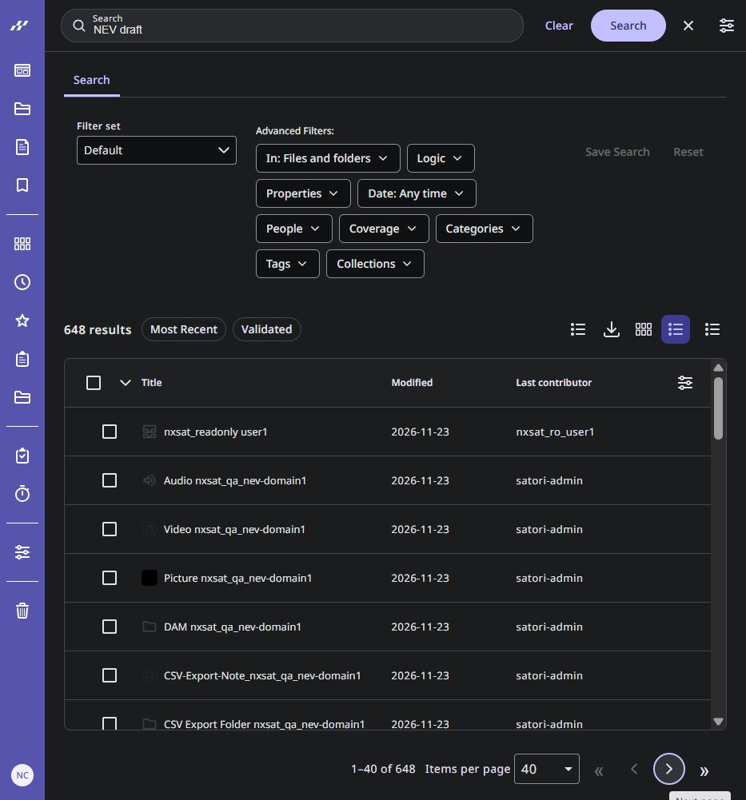
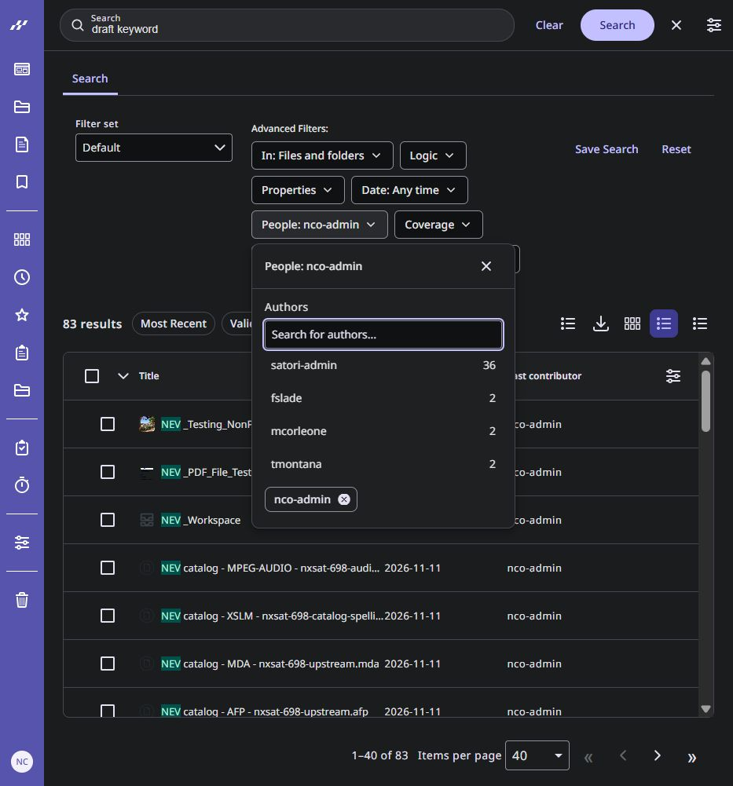
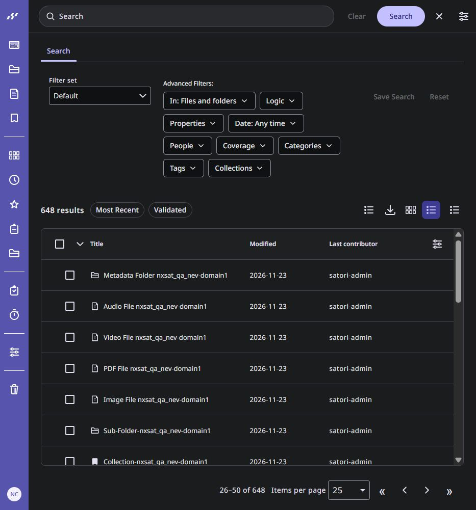
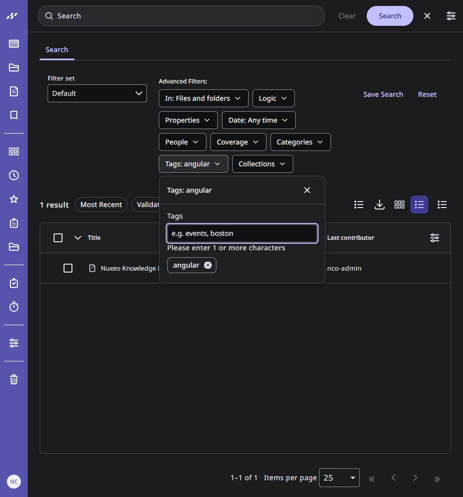
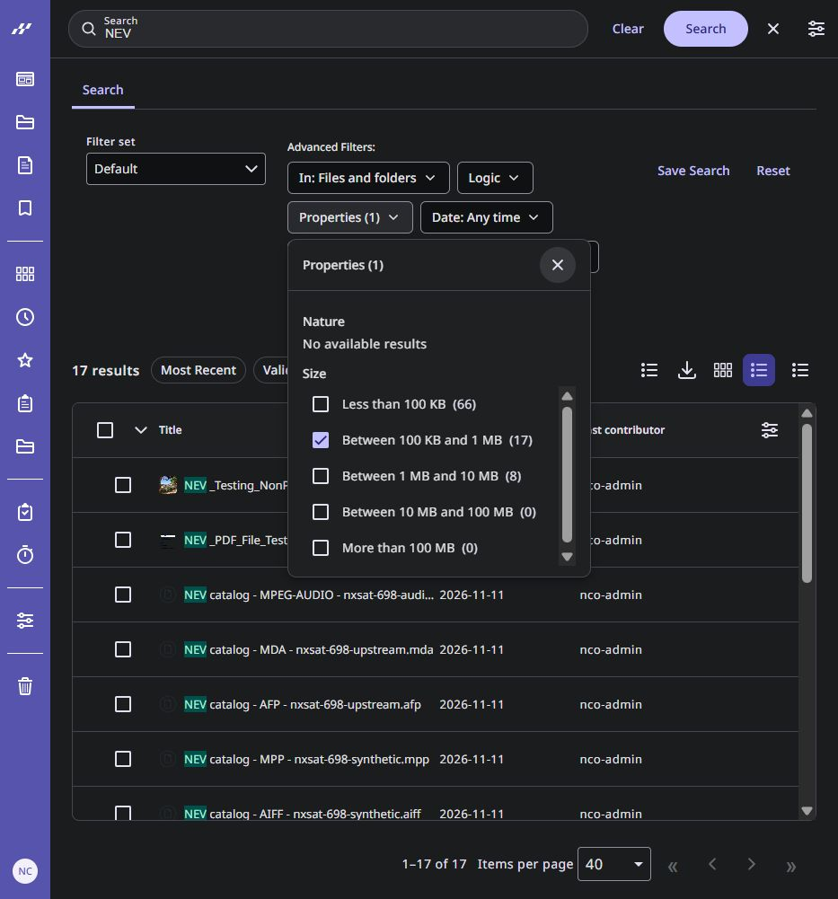
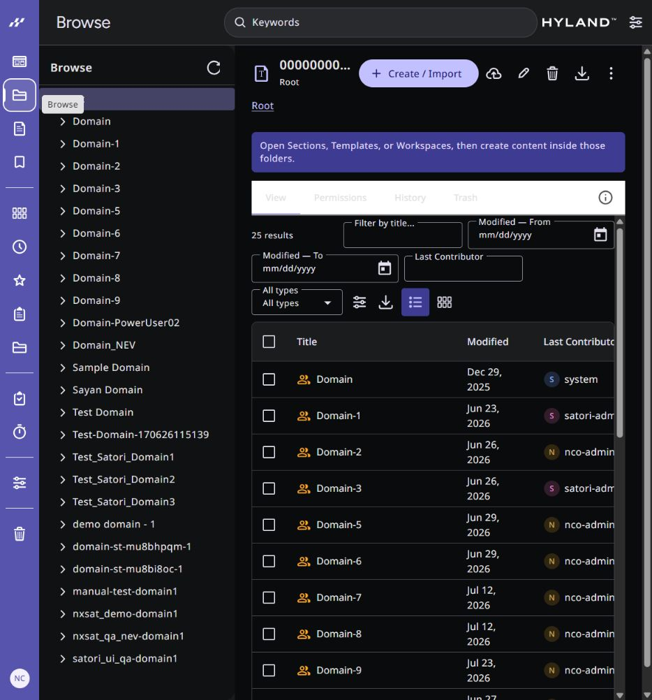

# NXSAT-820 verification

Browser verification on 25 November 2026 used the merged branch, Satori UI 1.0.0,
and `http://localhost:4204` connected to `https://satori-ui.beta.nuxeocloud.com/`.
Counts reflect that environment's data at verification time. Screenshots were captured
from the running application, not generated mockups.

## Scope

Grouped navigation and a search workspace built with Satori, Angular Material and existing
shared components. Existing search endpoints, aggregation keys and filter semantics are retained.
Department and new app-area, current-folder and Assets search scopes are excluded by agreement.

## Observed interactions after merging main

| Area                        | Observation                                                                                                                                                                     |
| --------------------------- | ------------------------------------------------------------------------------------------------------------------------------------------------------------------------------- |
| Navigation                  | Five groups and no extra Search sidebar entry. Browse opens its existing tree and results.                                                                                      |
| Collapsed Browse separators | All four separators measure 40px. Expand/collapse works.                                                                                                                        |
| Header                      | Keywords when collapsed and Search when expanded. Escape, click-to-reopen, Clear and keyword submission work.                                                                   |
| Keyword results             | Enter with NEV returns 125 results. An unmatched term returns zero; Clear restores 648.                                                                                         |
| Suggestions                 | Dark-theme text is readable. Selecting NEV_PDF_File_Testing navigates to its document UUID.                                                                                     |
| In                          | Applying existing Files-only narrows NEV from 125 to 112. Draft cancellation is also covered by the rendered component test.                                                    |
| Properties / Size           | Between 100 KB and 1 MB narrows NEV to 17. Removing it restores 125. Nature options and counts render. Nature selection was exercised in the 24 November pre-merge pass.        |
| Date                        | Files-only plus Last week returns 34 results. Existing multi-select date ranges remain.                                                                                         |
| People                      | Selecting nco-admin produces its removable chip and 366 results on the default search.                                                                                          |
| Categories / Coverage       | Technology/IT returns 25. Adding Asia/Japan narrows it to 7.                                                                                                                    |
| Tags                        | Selecting the angular autocomplete suggestion returns one result; removing it restores 648. Repeated after the chip-input fix on a fresh page, with no new browser errors.      |
| Collections                 | Marketing Documents nxsat_qa_nev-domain1 returns four results.                                                                                                                  |
| Saved searches              | Existing saved NEV search reopens with 125 results. Clear restores Default. Saving and reopening a new collection filter set restores its selected collection and four results. |
| Reset                       | Clears metadata and the Validated quick filter; the default search returns 648 results.                                                                                         |
| Paging                      | Last shows 121–125 of 125 and disables Next. First works; choosing 25 changes the page size.                                                                                    |
| Selection                   | Select page selects 25. Select all results selects 125. Clear removes the selection.                                                                                            |
| Views / columns / sorting   | Grid, List and Table switch correctly. Type column can be added and removed. Title sorting puts Apple first.                                                                    |
| CSV                         | Export downloads the current page, with 25 data rows; its first title is Apple after title sorting.                                                                             |
| Queue                       | Opens the existing document queue, displays Apple, and returns to filters with NEV restored.                                                                                    |
| Dropdown dismissal          | Close and Escape work. Advanced Filters collapses and expands. Focus restoration, scope drafts, and registered chip replacement have rendered regression tests.                 |

The saved filter set `NXSAT-820 post-merge verification 2026-11-25` remains available
on beta for reviewers. No destructive bulk action was executed.

## Prototype comparison and deliberate limits

The linked Claude prototype was accessible during this pass. Its grouped navigation,
expanded search header and dropdown presentation informed the implementation.

- Department and new Location/app-area/current-folder/Assets scopes remain excluded.
- Coverage retains geographic metadata semantics; it is not relabelled as the prototype's
  Location app-area selector. Collections retains the existing collection filter.
- Date keeps Last 24h/week/month/year/older. Prototype Today/Earlier options would change
  search semantics, so they are not substituted.
- Satori 1.0 supplies its standard navigation branding, icons and selected-item treatment.
  These differ from the prototype's custom shell artwork; this is not a pixel-identical shell.
- Logic and User's Configurable View remain prototype placeholders. Existing Properties,
  People and metadata filters remain functional even where the prototype has placeholders.
- AI Ask is disabled in this signed-in session. Its backend was not exercised live; automated
  search tests cover the separate Ask input and state. This report does not claim AI backend validation.

## Integration fixes and automated evidence

- Resolved source conflicts with main and regenerated the English fallback and public API snapshot.
- Corrected the extension reference for the new sidebar and retained search queue descriptor.
- Explicitly typed the expanded-filter signal so Windows and Linux builds emit the same API
  declaration; this resolves the remote snapshot mismatch without changing runtime behavior.
- Added regressions for Files-only serialization, saved-search Default selection and errors,
  queue routing, page/all selection, date clearing, outside-click focus and stale Ask suggestions.
  The targeted search suite passes 142 tests, filters 27, filter models 34 and saved searches 14;
  both projects' spec files also pass TypeScript checking. The PR records the refreshed SonarCloud
  quality-gate verdict separately from the scan job, which can succeed when its gate fails.
- Preserved main's external-recipient navigation rules, drawer behavior, saved-search clearing,
  and registered chip-set replacement in both filter layouts.
- Fixed unstable chip inputs causing repeated change detection in a horizontal overlay.
  The focused filter suite passes all 24 tests, including the replacement-component regression.
- Affected lint and builds pass. After the fixes, all 325 extension, 248 search and 2,168
  shared-component tests pass; the app suite passes all 687 tests. The broad pre-commit
  run also included unchanged configuration-generator tests, which fail locally on
  Windows stderr, line-ending and symlink expectations. That run is not an all-green test run.
  Remote CI results are recorded in the PR; existing build/lint warnings remain.
- The final run against the committed diff passes all 53 lint/build/test tasks for 25 affected
  projects, with 7,445 tests (6,758 Vitest and 687 app/Karma). Spec type checking and the
  public API/reference checks also pass. The subsequent RTL adjustment replaces `left`
  with `inset-inline-start`; its lint, stylesheet and build checks are rerun separately.

## Screenshots

### Follow-up Copilot review — 25 November 2026

Four additional findings are addressed:

- The optional queue resolves `app.navbar.search` through the extension registry independently
  of sidebar navigation. Customer labels, paths, visibility, registered descriptors, and rules
  retain their existing semantics. The Search sidebar item remains absent.
- A keyword typed after focusing the collapsed header survives clicking the field and entering
  the Search route. Intentionally empty drafts are preserved too; Escape/reopen restores the
  applied keyword when there is no draft.
- Save As initializes cached parameters from the newly created search's own payload. Regression
  tests reproduced the previous search's layout/column leak in both Files-scope directions before
  the fix, and cover failed creation and a response without an ID.
- Select all appends each page to an operation-local accumulator, avoiding repeated copies of
  earlier pages. Tests confirm that source response arrays stay unchanged, later operations start
  empty, and the existing cancellation/error behavior remains intact.

These follow-up paths are covered by browser/component and service regression tests. The screenshots
below document the live beta UI checks described in the preceding sections; they are not evidence
of changing a customer's manifest or reproducing the saved-state leak against the live server.

The live follow-up check confirmed that `NEV draft`, typed after keyboard focus on Dashboard,
survived click activation and the Search navigation. An explicitly empty draft also survived;
Escape followed by reopening restored the applied `NEV` query. Submitting NEV and opening/returning
from the registered queue retained all 125 results. The check also exposed a loading-time race:
Queue could act on stale results. Its control and handler now prevent activation while search is busy.
The live recheck observed Queue disabled alongside the loading spinner, enabled after completion,
and opening/returning with the same 125 NEV results.

### Copilot regression verification — 25 November 2026

The review found seven defects. The follow-up preserves saved-search presentation state across
successive saves, keeps unsubmitted keywords during metadata changes, opens search only on explicit
activation, synchronizes removal of the queue's No Containers filter, persists page size in links,
cancels pending select-all work through every shared Clear action, and restores focus after choosing
an author, collection or tag. Department and new search scopes remain excluded.

Fresh browser checks against beta confirmed:

- Shift+Tab from Settings focuses Keywords while remaining on Dashboard; Enter opens search with
  NEV and returns 125 results.
- Choosing nco-admin with Enter keeps the header's `draft keyword` text, returns 83 results for
  the already-applied NEV query, and restores focus to Authors.
- `/#/search?pageSize=25&page=2` shows 26–50 of 648 before and after a full reload.
- Files returns 485 results; clearing No Containers in Queue and returning to Filter view restores
  Files and folders and all 648 results.
- Keyboard activation of the angular tag and Marketing Documents collection restores focus to
  the respective input. Escape dismisses the panel; Reset restores all 648 results.
- Native dialog/fieldset markup retains the dropdown layout and Date checkbox behavior.

Automated regression tests additionally exercise consecutive metadata/Files saves and cancellation
of an in-flight select-all request through the header checkbox and shared shell Clear action.
These timing-sensitive cases are covered by controlled observable responses, not claimed as manual
race-condition reproduction.

Search workspace:

Readable suggestions:

Date dropdown with existing server ranges:

Size filter:

Tags with a selected, removable chip:

Saved collection search restored:

Selection across all result pages:

Browse with 40px collapsed navigation separators:

