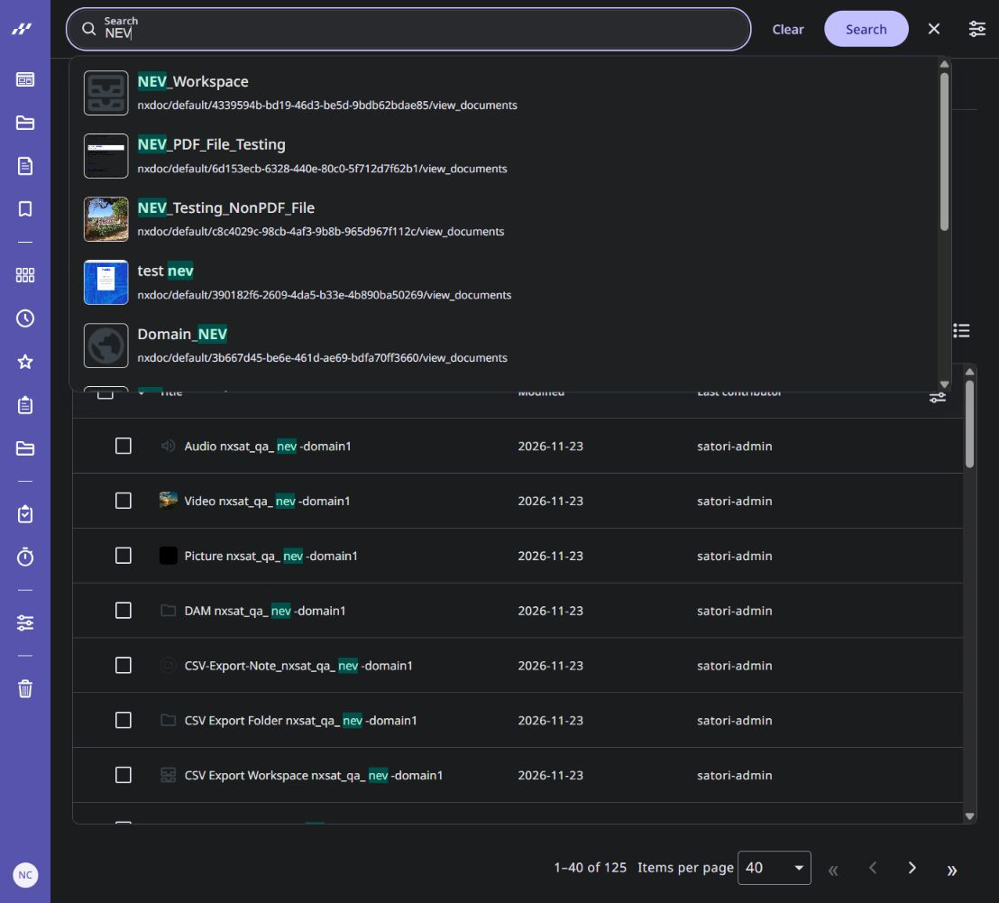

# NXSAT-820 verification

Verified on 24 November 2026 using the local preview at `http://localhost:4204` against
`https://satori-ui.beta.nuxeocloud.com/`. These observations apply to this branch before
integration with the latest main branch. Counts reflect the test data at verification time.

## Scope

Grouped navigation and a search workspace using Satori, Angular Material and the existing
shared components. Existing search endpoints, aggregation keys and filter semantics are retained.
Department and new app-area, current-folder and Assets search scopes are excluded by agreement.

## Observed interactions

| Area                   | Result                                                                                                         |
| ---------------------- | -------------------------------------------------------------------------------------------------------------- |
| Navigation             | Five groups; no extra Search sidebar item; configurable view opens its own prototype placeholder.              |
| Collapsed separators   | All four lines measure 40px; expand/collapse retains the existing expanded margins.                            |
| Search header          | Keywords when collapsed, Search when expanded; Clear, Close, Escape and click-to-reopen work.                  |
| Keywords               | Enter and Search execute NEV and return 125 results.                                                           |
| Suggestions            | Readable in dark mode; selecting the PDF suggestion opens its document.                                        |
| In                     | Existing Files-only filter changes 125 results to 112; Close discards an unapplied draft.                      |
| Properties             | Nature Article returns 24 results. Size options render; selecting a size was not exercised live.               |
| Date / People          | Last week returns 34 results for the tested Files search; adding nco-admin narrows to 2.                       |
| Categories / Tags      | Technology/IT returns 25 results; angular tag returns 1; removing the tag restores results.                    |
| Coverage / Collections | Asia/India returns 1 result; the tested Marketing Documents collection returns 4.                              |
| Saved searches         | Save, switch to Default and reopen restores NEV and 125 results.                                               |
| Reset                  | Clears metadata and quick filters; Validated-only reset restores 648 results.                                  |
| Paging                 | Next, Last and First work; final-page Next is disabled; page-size selection works.                             |
| Views / columns        | Table, List and Grid work; adding and removing a column works.                                                 |
| Selection              | Select page and Select all results work; clear removes the selection. No destructive bulk action was executed. |
| Sorting / empty state  | Title and Most Recent work; an unmatched keyword shows zero results and Clear recovers.                        |
| CSV                    | Export downloads the current page: 40 rows and 12 columns in the tested configuration.                         |
| Queue                  | Opens a result, switches documents and returns with the keyword restored.                                      |
| Dropdowns              | Open/close, Escape with focus restoration, draft cancellation and advanced-filter collapse/expand work.        |

The live verification saved a search named `NXSAT-820 UI verification 2026-11-24` for review.
AI Ask was disabled in that session, so its backend interaction was not verified live.

## Automated validation

- Affected lint, build and test: passed for 24 projects, 50 tasks (46 cached on the final divider run).
- 6,496 tests across the affected suites; the app suite reports 526 passing tests.
- Modified shell stylesheet: Stylelint passed. `git diff --check` passed.
- Existing lint and build warnings remain; these checks were not warning-free.

## Remaining review items

- Integrate with current main and rerun validation before declaring merge readiness.
- The prototype Date menu uses Any time / Today / Earlier. Existing server ranges such as
  Last 24 hours / Last week remain because they have different semantics.
- Satori branding, some icons, active-state styling and spacing still differ from the prototype.
- Logic and configurable view remain placeholders consistent with the prototype.
- Complete live Size-filter and AI Ask verification where configured.

## Screenshots

Search results:

Readable suggestions:

Date dropdown with retained server ranges:

Browse with corrected collapsed navigation separators:

